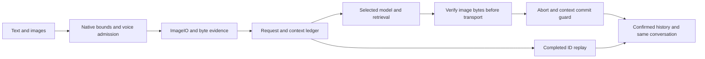

# Alden 0.3.69 — text and image input

The existing conversation reader now accepts an explicit text message and up to four PNG/JPEG/WebP/GIF images. A typed request can start a conversation or continue the selected one. It uses the saved model selection; the current user-selected default is `google-antigravity/gemini-3.8-flash`, high, manual. Local inference remains subject to model readiness and RAM admission. Images unsupported by the selected model fail explicitly.

## Intake and ownership

The native bridge bounds the request and passes it to the packaged Python runtime with `-E -B -s`. Original bytes are parsed with native ImageIO, then stored privately with SHA256 evidence. Limits are4 images,8MiB each,20MiB per request,16Mi decoded pixels,128MiB decoded rasters,64 GIF frames and an8-second decoder deadline. The raster budget does not cap total process RSS. No Pillow or new model runtime was installed.

`request_id`, `conversation_id`, `turn_id` and `context_version` bind admission, history, inference and completion. A persistent request ledger distinguishes a completed replay from a new input. Cancellation and newer-turn ownership prevent late results from committing or updating a retired view. The original emergency gate also applies to isolated verification. The history database initializes atomically under a private lock; source Kakao data is not migrated or written.

Original and completed same-conversation image evidence is checked again before HTTP transport. Changed bytes fail before a provider call. Current images take precedence; previous completed images are carried when no current images are present. Broader mixed-image comparison and failed-turn context remain unverified.

Known transport/native failures retain a bounded code and preserve the draft. Raw process errors and state paths are not echoed. IME completion, edited drafts, retries, page changes, hidden windows and stale replies have explicit ownership fences.

## Reproduced failures and verification

An initial native inference completed but its screenshot filename was rejected; the fixed names were admitted. A later intake failure was traced to Darwin process enumeration: `KERN_PROCARGS2` can return EINVAL for a vanished PID. Signal zero also succeeds for zombies. The bridge excludes only independently confirmed absence or the exact same-UID/PID zombie. Live, permission and unknown failures still block admission. No process is signalled or adopted by these checks. [Apple process handling](https://github.com/apple-oss-distributions/xnu/blob/main/bsd/kern/kern_sysctl.c), [signal-zero handling](https://github.com/apple-oss-distributions/xnu/blob/main/bsd/kern/kern_sig.c).

Native input verification initially evaluated an empty/loading document and later observed a genuinely hidden document. The final audit waits for the owned asset, actual DOM/modules and status wiring, then uses the production focus path on its own window and waits for real activation. It preserves hidden-state input protection. An early audit IPC call was separately reproduced and corrected: Tauri2.11.6 appends invocation initialization before metadata/core initialization. Three actual-script DOM regressions cover initialization order, late controls and pending status. [Tauri page-load hook](https://docs.rs/tauri/2.11.6/tauri/struct.Builder.html#method.on_page_load). The project pin remains2.11.6; the current publisher reference showed2.12.3.

| Evidence | Result and scope |
| --- | --- |
| Source checks | UI603 before final error/readiness cases; composer67; Python93; native125 plus load gate; strict Clippy/type/Vite; final CI records the complete counts |
| Final candidate | Corrupt images12/12; red PNG answered `빨간색`, contextual followup `42`, same conversation |
| Installed0.3.69 | Corrupt images12/12; exited1/zombie1 independently confirmed; actual red/42 inference and durable same-conversation display |
| Completed replay | Same first answer; requests2/messages4/session1 unchanged; new inference0/messages0 |
| Rendering | Candidate and installed read-only14 states/26 PNG each; two-size composer and final installed answer screenshots directly inspected |
| Preservation |60 files/modes matched, strict/deep ad-hoc signature, no generated bytecode;3 settings/7 targets/2 policies/model listeners and original empty voice history preserved |
| Recovery | Independent0.3.67 baseline57 files and successive installer checkpoints retained |

The final installed two-input audit took7805ms; the invalid12 audit took4687ms. These are single full-audit observations with setup, parsing, model work, storage and capture. They are not UI first-paint, TTFT, inference throughput, whole-app resource or percentile measurements. Failed audits and one overlapping observation are retained; overlap alone is not presented as the cause.

Physical typing/file picker, microphone, gestures, Retina transitions, broad file/link parsing, mixed-image contexts, per-request model metrics and wider upstream model availability remain separate gates. The source-store gold/normalization/merge, multi-host, DPO and signed production release requirements remain active. The prior0.3.67 graph styling and synthetic rebuild measurements are unchanged.

Private local evidence is under `outputs/assistant-input-completion-20261012` in the parent task workspace. Runtime source is3138d98c5fea06b531b50c7431a0c4cf927cbedf; later documentation commits do not change the installed binary.
