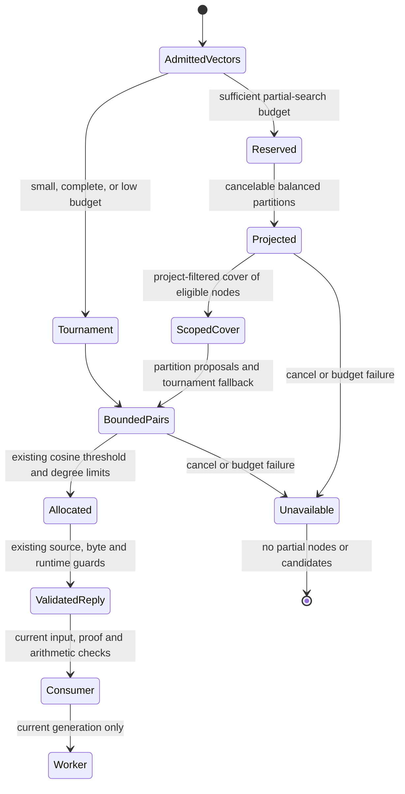

# Bounded partition sampler: source candidate and delivery gates

This candidate follows the [numerical oracle](affinity-neighbor-oracle-20261025.md).
It generalizes the fixed-page experiment and connects truthful work counters to
the real frontend. It is not installed. The app remains0.3.219/sourcea09cd79.

## State and authority

The chart is a review surface, not a database transaction, liveness proof or
complete product model. Source admission still binds current permitted versions,
retained original bytes, text/vector hashes and the pinned E5 profile. Read
transactions remain independent; no global multi-DB atomicity is inferred. The
sampler adds no factual relationships, identity merges, index writes or knowledge
activity. Real source relations and user pins remain independent of S candidates.

## Arithmetic and coverage

On the partition path let128≤N≤2,048, D=384, F=4, W=16 and leaf size16. Global balanced partitions bound
projection products by F·N·ceil(log2(N/16))·W and record the actual count. Project
membership is reapplied in every leaf before scoring. Projection work is bounded
independently of overlapping project labels.

The permitted cover adds a pair only when at least one endpoint is uncovered;
the final odd member uses another group member. Flags never clear. Every
eligible group member is covered without self/disjoint pairs, using at most N
pairs. The new branch reserves enough capacity to emit this cover first. Small,
complete and low-budget inputs keep their existing tournament behavior.

A bitmap prevents repeat scoring across cover, partitions and fallback.
Dot products are capped at
`min(max_pairs, floor((max_products - projection_products) / 384))`.
Projection arithmetic therefore stays inside the existing cap. Source bytes,
RSS, CPU, wall time, cancellation and final allocation remain guarded. Sort/hash
overhead is guarded and measured separately. The bitmap still has O(N²) bits;
partition sorting and project grouping add costs. This is bounded snapshot work,
not unbounded linear scalability or exact nearest search.

The frontend recognizes `sparse-partition-tournament-v1`, independently recomputes
balanced-tree projection cost, checks total work against bounded declared budgets
and validates coverage/seed consistency. Historical absent work remains null;
measured fallback work reports zero projections. Inconsistent tuples fail closed.

## Verification

Seven helper cases include all5,461 two-project membership patterns through six
nodes, overlapping/isolated scopes, uniqueness, fallback/reservation, projection
cancellation and evaluator order invariance. These are bounded actual-code checks,
not an all-input or whole-app theorem. Three real helper mutations are detected:
omitting an odd cover member, dropping the leaf project filter and failing to
reserve projection arithmetic.

The actual1,984-node career reply passes the production TS parser. It compares
63,221 pairs, reaches every eligible node53–67 times, and reports992 cover pairs,
888,832 projection products and25,165,696 total products under25,165,824. Selected
top3 incidence is631/5,952 (10.60%), versus the installed sampler's144/5,952
(2.42%); selected endpoint coverage is1,802, maximum degree4. This is vector
quality, not semantic gold.

One read-action observation measured CPU4.584s, wall6.536s and peak RSS104,972,288B
while other tests ran. It fits8s/20s/128MiB for that observation, not a speedup,
representative latency or worst-case bound.

## Unmet delivery gates

Cold-start geometry on the same current R graph has14 world pairs below.07
versus10, and289 fitted four-pixel pairs versus285. A lower common-camera quarter
population does not establish that central crowding is solved.

The initial old-policy transition preserved three explicit pins and an exact
unchanged repeat, but ordinary-node movement reached2.215 world units. This was
not confined to a policy migration: removing one existing S pair under the same
policy moved1,976 unpinned nodes, with median0.411 and maximum1.805. The impact
component includes R hub spokes and its bounded solve still has residual forces.

Two isolated alternatives were compared. A stronger prior spring reduced the
unpinned one-pair median to0.136 but retained a1.399 maximum. The selected source
candidate instead constrains cached ordinary updates to a0.14-world-unit trust
region around the supplied prior during each solver step. The same guard covers
the final coincident-point correction. Source relations, semantic scores and
community membership are not changed by the constraint. Cold/new nodes, explicit
reflow and a changed authoritative pin frame keep the unconstrained path.

Six actual-graph cases (policy change, one S-pair removal and one node removal,
each with zero or three pins) now have maximum displacement0.14, exact retained
pins, an unmodified prior and an exact unchanged repeat. Four maintained regression
cases cover the displacement bound, checkpoint restore, explicit reflow, invalid
restored coordinates and a prior just one rounding step outside the ellipsoid. A
copied actual-source mutant disabling the guard fails the same actual-graph
assertion. These are finite engine checks, not native pixels, physical input,
equilibrium convergence or an all-input numeric proof. The impact set remains
broad; the constraint is not a claim of local-only recomputation or zero drift
across a sequence of distinct source updates.

The final helper revision was freshly exported through the actual admitted
read action: the same1,984 nodes and input hash reproduce631/5,952 top3 incidences.
The final helper observation used CPU3.447s, wall3.781s and peak RSS104,153,088B. This remains one observation, not a speedup or worst-case performance proof.
Python100, UI1,218, TypeScript and seven exact-resource tests pass. The resource
test caught a missing Tauri map entry for the new helper; the map now includes it
without weakening the allowlist or packaged missing-input guard.

This is an uninstalled source candidate. Cold density above, repeated live-update
locality and native acceptance remain delivery gates. The installed0.3.219 app
still matches all85 signed artifact files and retains its already verified
zoom-in-only passive label policy.

Native background/minimized QA, physical/Retina/camera interaction, representative
resources and larger independent content/semantic/time/identity gold remain open.
Existing raw-source, permission, queue, worker and normal-release holds remain;
current-source Pro→Gemini→Pro review is NOT_RUN under the earlier readiness hold.
No model, embedding prefix/profile or installed app was silently changed.
