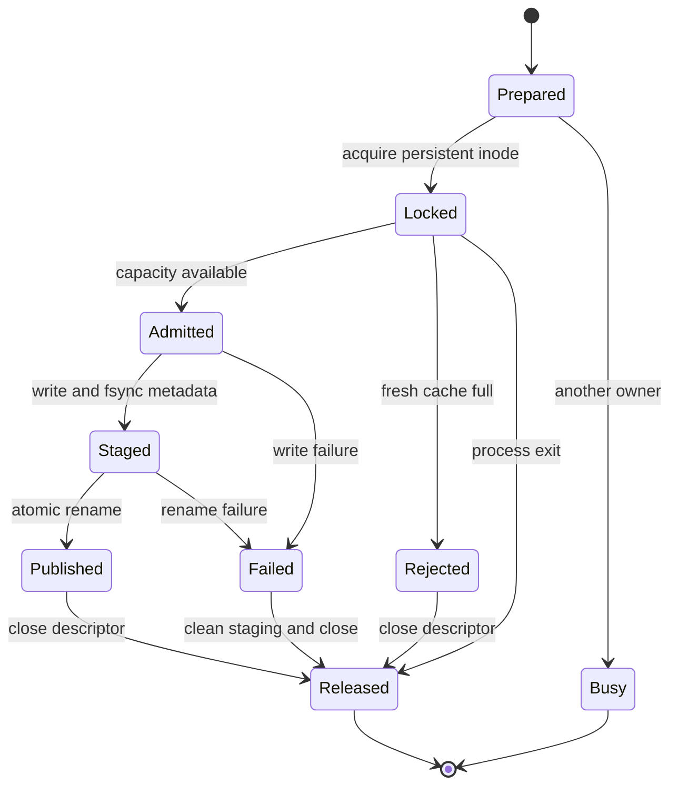

# Annotation review publication ownership

Base source: `3407c08e8e3bdf14b378735bb7048e4398dbaede`.

Two candidate-review requests could both observe 15 fresh review JSON files,
pass the limit of 16, then publish distinct files. A regression through actual
`create_review` calls in two processes reproduced **17 files**. Atomic rename
published each file safely but did not serialize capacity admission.

The candidate holds one nonblocking advisory lock across the existing capacity
check, expired-metadata handling, staging and rename. A contender returns the
internal `annotation_review_cache_busy` error; the quality action retains its
existing `quality_annotation_review_unavailable` response. Source verification
and candidate calculation remain outside this short ownership region. The
change does not alter source records, annotations, identity or merge policy.

The private lock must be a regular, single-link, empty, owner-controlled 0600
file. Symlinks, hardlinks, directories, nonempty files and shared permissions
are rejected. Its inode remains in place: deleting a lock pathname on release
could let later callers lock another inode while the first is still owned.
Closing its descriptor releases ownership, including after process exit.

## State and property



Writing, fsync and rename are separate operations. The lock prevents another
cooperating publisher from interleaving admission and publication; it does not
turn the whole region into a filesystem transaction.

| Claim | Evidence and limit |
| --- | --- |
| Starting within capacity, these publishers cannot increase review JSON count beyond the limit. | Actual two-process, 15-existing/cap16 regression; baseline and an unlocked writer both produce 17, guarded source stays at 16. |
| Failure does not permanently retain ownership. | Real process exit while holding the lock, and an injected rename failure, followed by successful normal publication. |
| Contention does not expose source content or damage prior reviews. | Existing public failure contract, original source DB byte comparison, retained existing JSON files and private metadata contract tests. |
| The description is sensitive to the guarded defect. | Disabling the guard in one real writer makes the regression fail; restoring it passes without changing source bytes. |

A separate bounded interleaving check covered two actors, capacities 1–3 and
every initially valid count (nine cases), with publication, busy/full rejection,
write failure and owner exit. It found the unguarded counterexample and no
guarded capacity violation in those bounds. Both successful publications were
reachable when two slots were available. This is a model check plus real-code
regressions, not an all-input implementation proof. Liveness was not checked.

Assumptions: publishers share this implementation and the same persistent lock
inode on a supported local filesystem. External folder/lock replacement,
legacy writers, power-loss durability, staging leftovers after a hard crash,
and total folder byte budgets are outside this count-only claim. An already
overfull legacy cache is rejected, not silently repaired or purged. Existing
expired-review handling is unchanged.

## Verification and delivery boundary

Related local checks: **114 tests**, comprising 14 annotation-candidate tests,
44 quality-action tests and 56 graph-quality tests, all passed on the pinned
CPython 3.11 runtime. Re-run the producer regressions with the project runtime:

```sh
python3 -B -m unittest discover -s tests -p test_alden_annotation_candidates.py
```

Private baseline failures, mutation/restoration receipts, bounded-model output
and actual-store read-only audit evidence are retained under the task's
`outputs/quality-boundaries-20261024/`. Actual source content is not included in
this document or commit.

This remains an uninstalled candidate. The original approved review packet
retains its exact bytes; a subsequent applicable source-delta review and
integration gate are still required. Local tests do not attest installation,
native UI, broader graph semantics, deduplication truth or completed external
cross-audit.
