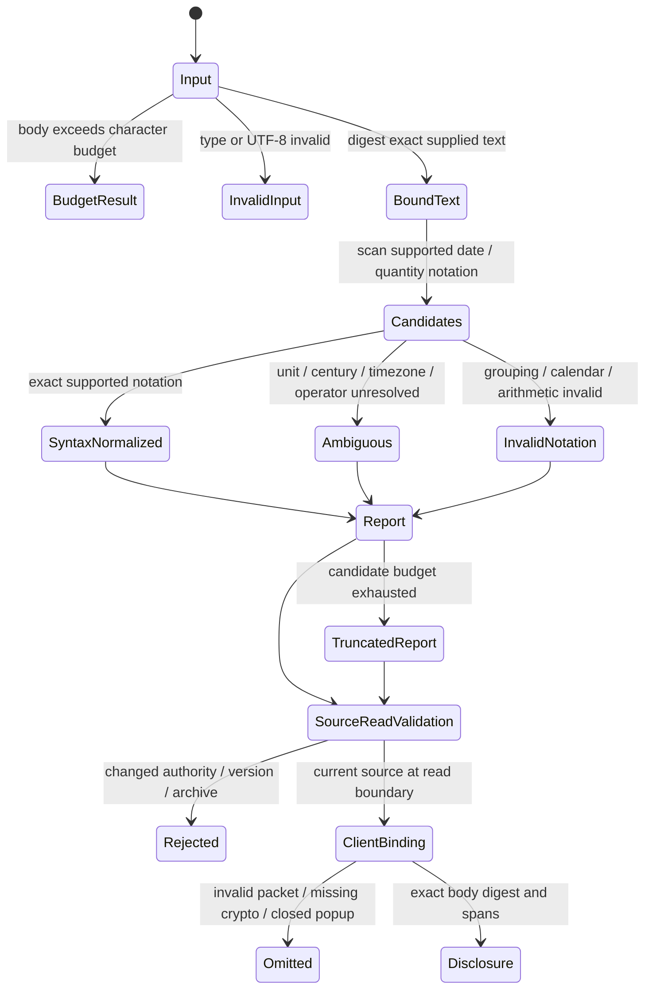

# Body notation candidate parser

The installed quality scan of 12,561 permitted career versions found no explicit
quantity/time metadata fields. That is a coverage gap; it does not establish that
body numbers or dates were normalized. The pure parser now connects to the
source-detail read API and a collapsed source-popup disclosure. Its module is
included in the desktop and immutable-worker resource lists. It does not write
ingestion, search indexes, graph facts or a persistent annotation database.

`scripts/alden_body_normalization.py::analyze_body_fields` accepts the exact body
string and returns lexical candidates bound to its UTF-8 SHA-256. Source text is
not rewritten, normalized to NFC, merged or discarded. Every candidate includes
its exact substring, Unicode-codepoint offsets and JavaScript UTF-16 offsets.
The caller must validate permission, current document/version and body digest
before exposing results. The API checks current membership, permissions, native
source authority, projection/version identity and the retained archive again
after analysis, and after the entity projection before returning the packet.
These are bounded read validation points, not perpetual freshness after delivery.

The popup independently checks the node/target/version/archive/excerpt binding,
UTF-16 and codepoint spans and a WebCrypto digest of the exact delivered body.
Failed/absent WebCrypto omits annotations and keeps the original source readable.
Close, replacement and failed-response paths remove the pending disclosure, so
an old asynchronous digest cannot attach to a newly selected source. Quotes use
literal DOM text. Canonical decimal strings never pass through JavaScript Number.
The disclosure separates notation from facts and shows excerpt/candidate limits;
short years, missing units and other ambiguity remain visible.

Supported notation includes year-first Gregorian dates and ISO-like times,
explicit physical/data units through the existing exact converter, count units,
explicit currency codes/literal won, Korean numeric magnitudes and percent versus
percentage points. `1억 2천만원` yields the number 120000000 in literal `원`; it
does not infer a national currency or exchange rate. `초봉 5천` can expose 5000
with no unit and an ambiguous status. Two-digit years, missing timezones,
hyphen-as-range-versus-subtraction, factual claim roles and temporal validity
are not guessed. Written endpoint order and explicit signs remain visible.

An immediately joined second timezone, sign/range marker or bracketed zone after
a clock must not turn its valid prefix into a normalized timestamp. For example,
`2026-02-23T12:30Z+09:00` and `2026-02-23T12:30:00+09:00-05:00` retain the exact
matched prefix and its offsets, with `unsupported`, no canonical value and
`time_suffix_not_fully_parsed`. The suffix is not silently interpreted or added
to the matched span. Sentence punctuation, Korean particles, line boundaries and
separate expressions retain existing behavior and declared time precision.

The safety promise is exact, bounded syntax annotation without invented units,
centuries, timezones or source authorization. It is not semantic fact extraction.
Inputs above 131,072 code points return a budget result with no claimed body
hash; candidate count is capped at 64 and numeric tokens at 128 characters.
Budget state/truncation must remain visible. URL tokens are excluded. Plain IDs,
relative dates, prefix-only currency expressions, repeated-unit interval
assembly, arbitrary locale formats and all possible Unicode operators are not
comprehensively supported. No-candidate output does not mean a body lacks
numbers, dates or meaningful knowledge.



This is a conceptual projection of the parser and implemented read/display
boundaries, not a formal liveness proof or fact-store promotion. Concurrent-state
regressions use private synthetic databases and fake native authority adapters.

For body length N and returned count C <= 64, hashing, URL scanning and the UTF-16
boundary map traverse at most O(N). Three lexical streams use a fixed 128-character
numeric window; decimal precision and unit tables are fixed. Storage is O(N+C)
because URL intervals may grow with input. These are code-derived bounds with
fixed grammar constants, not a wall-clock SLA or a generic linear-time claim for
unbounded regexes. Numeric candidate normalization uses a private exact Decimal
context; the existing SI converter retains ownership of its final exponent
budget, including valid down-conversions such as `100e100 mg`.

Run checks with the pinned project Python and `-B`:

```sh
python3 -B -m unittest tests.test_alden_time_normalization tests.test_alden_quantity_normalization tests.test_alden_normalization_evidence tests.test_alden_body_normalization tests.test_alden_body_details -v
python3 -B scripts/verify_alden_body_normalization.py --output /absolute/private/fresh/body-verification.json
```

The verifier checks current and restored source and rejects seven deliberately
broken source copies: lost signs, wrong magnitude, wrong UTF-16 offsets, malformed
grouping admitted, guessed century, URL numbers admitted and ignored joined time
suffixes. Mutations occur only
in temporary copies and the working parser remains unchanged. Tests include 112
generated standalone magnitude cases and ten compound cases using independent
integer sum/product oracles, plus 39 joined timestamp suffix cases and 24 valid
timestamp boundary controls. The source-detail read regression binds the changed
result to the unchanged displayed body and exact codepoint/UTF-16 spans.
These are bounded checks, not a theorem, a full
Unicode grammar audit, independent semantic gold or an installed product result.

Offline evaluation of two saved canonical source pairs (four records, two unique
bodies) verifies exact body binding and spans. It is not fresh acquisition or
current permission revalidation. A synthetic URL-only scan forces complete
traversal without hitting the candidate cap; its CPU timings are separate from
whole-app latency, resources and any before/after improvement claim.

Application regressions include committed version changes, project/native grant
revocation, native revision changes, stored-body corruption, archive substitution,
late entity projection and legacy schema reads. Frontend regressions cover exact
parser output, malformed packets, emoji offsets, delayed digest cancellation,
literal HTML, bounded disclosures and canonical IDs in the unified graph.
The pure-parser complexity discussion excludes the caller's database queries and
bounded archive revalidation; it is not a whole-popup performance claim.

Representative independent date/quantity/temporal gold, installed UI readback and
external-review/release evidence remain separate promotion gates. Installation
and runtime evidence are recorded in the task's current delivery report, not
inferred from local tests. No source merges, semantic relations or expired-job
decisions follow from this parser alone.
