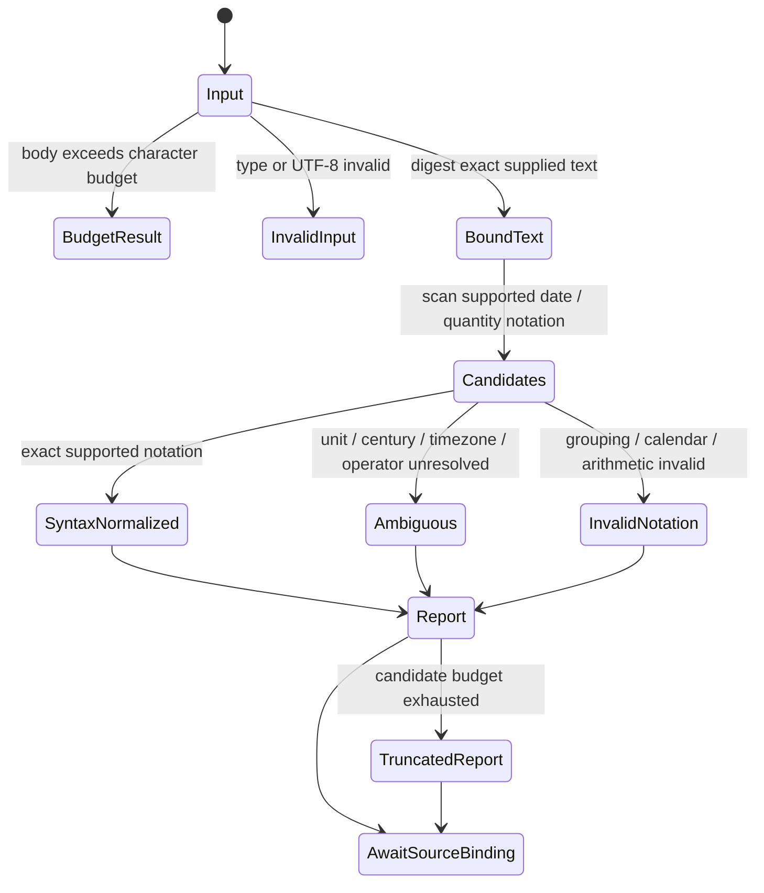

# Body notation candidate parser

The installed quality scan of 12,561 permitted career versions found no explicit
quantity/time metadata fields. That is a coverage gap; it does not establish that
body numbers or dates were normalized. This branch prepares a pure, unshipped
parser for that next boundary. It is not wired into ingestion, search, graph
facts, the UI, a resource allowlist or a persistent database.

`scripts/alden_body_normalization.py::analyze_body_fields` accepts the exact body
string and returns lexical candidates bound to its UTF-8 SHA-256. Source text is
not rewritten, normalized to NFC, merged or discarded. Every candidate includes
its exact substring, Unicode-codepoint offsets and JavaScript UTF-16 offsets.
The caller must validate permission, current document/version and body digest
before exposing or retaining results. That caller integration is still pending.

Supported notation includes year-first Gregorian dates and ISO-like times,
explicit physical/data units through the existing exact converter, count units,
explicit currency codes/literal won, Korean numeric magnitudes and percent versus
percentage points. `1억 2천만원` yields the number 120000000 in literal `원`; it
does not infer a national currency or exchange rate. `초봉 5천` can expose 5000
with no unit and an ambiguous status. Two-digit years, missing timezones,
hyphen-as-range-versus-subtraction, factual claim roles and temporal validity
are not guessed. Written endpoint order and explicit signs remain visible.

The safety promise is exact, bounded syntax annotation without invented units,
centuries, timezones or source authorization. It is not semantic fact extraction.
Inputs above 131,072 code points return a budget result with no claimed body
hash; candidate count is capped at 64 and numeric tokens at 128 characters.
Budget state/truncation must remain visible. URL tokens are excluded. Plain IDs,
relative dates, prefix-only currency expressions, repeated-unit interval
assembly, arbitrary locale formats and all possible Unicode operators are not
comprehensively supported. No-candidate output does not mean a body lacks
numbers, dates or meaningful knowledge.



This is a conceptual projection of a synchronous pure call, not a transaction,
liveness proof or implemented source-binding state machine. AwaitSourceBinding
names the next unimplemented application boundary, not a fact-store promotion.

For body length N and returned count C <= 64, hashing, URL scanning and the UTF-16
boundary map traverse at most O(N). Three lexical streams use a fixed 128-character
numeric window; decimal precision and unit tables are fixed. Storage is O(N+C)
because URL intervals may grow with input. These are code-derived bounds with
fixed grammar constants, not a wall-clock SLA or a generic linear-time claim for
unbounded regexes. Numeric candidate normalization uses a private exact Decimal
context; the existing SI converter retains ownership of its final exponent
budget, including valid down-conversions such as `100e100 mg`.

Run checks with the pinned project Python and `-B`:

```sh
python3 -B -m unittest tests.test_alden_time_normalization tests.test_alden_quantity_normalization tests.test_alden_normalization_evidence tests.test_alden_body_normalization -v
python3 -B scripts/verify_alden_body_normalization.py --output /absolute/private/fresh/body-verification.json
```

The verifier checks current and restored source and rejects six deliberately
broken source copies: lost signs, wrong magnitude, wrong UTF-16 offsets, malformed
grouping admitted, guessed century and URL numbers admitted. Mutations occur only
in temporary copies and the working parser remains unchanged. Tests include 112
generated standalone magnitude cases and ten compound cases using independent
integer sum/product oracles. These are bounded checks, not a theorem, a full
Unicode grammar audit, independent semantic gold or an installed product result.

Offline evaluation of two saved canonical source pairs (four records, two unique
bodies) verifies exact body binding and spans. It is not fresh acquisition or
current permission revalidation. A synthetic URL-only scan forces complete
traversal without hitting the candidate cap; its CPU timings are separate from
whole-app latency, resources and any before/after improvement claim.

Before promotion: bind to the existing current-source/permission contract; expose
coverage, ambiguity and exact source spans; evaluate representative independent
date/quantity/temporal cases; test cancellation, stale versions and Unicode client
highlighting; then integrate packaging/UI/runtime and preserve the existing
external-review and release conditions. No source merges, semantic relations or
expired-job decisions follow from this parser alone.
