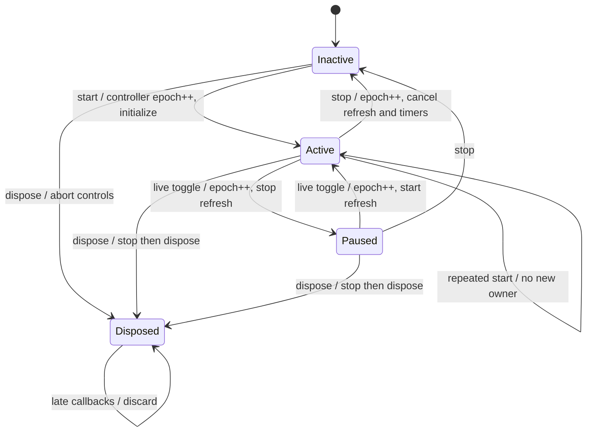
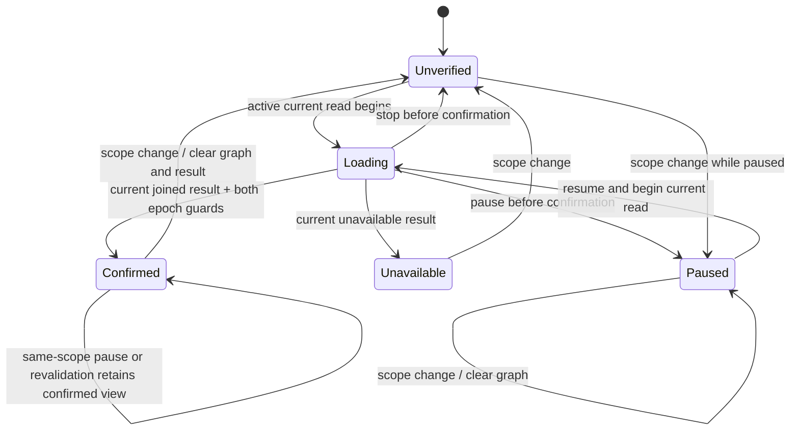

# Scope ownership review chart

Two planes below describe the covered promise. They summarize the code; no
equivalence or refinement proof between these diagrams and source is claimed.
Controller and refresh each own an epoch. All changes across await boundaries
must satisfy the corresponding owner's guard before applying a result.

`paused` is a retained flag, including while inactive. Starting an inactive,
paused controller does not start refresh until the user resumes. A scope change
is accepted by the controller only while not disposed; it increments the epoch,
stops refresh, clears graph/navigation/history and resets the result status.
Only an active, unpaused owner restarts reads.

`Confirmed` summarizes ready/empty/partial/stale classification; it is not one
literal DOM state. A current failed result can become unavailable, or retain a
previously confirmed same-scope view according to the existing failure path.
Obsolete replies have no transition that publishes their graph/result. The
diagram omits UI label microsteps and does not assert that every DOM mutation
is forbidden while stopped. A → B → A traverses two distinct scope epochs.
