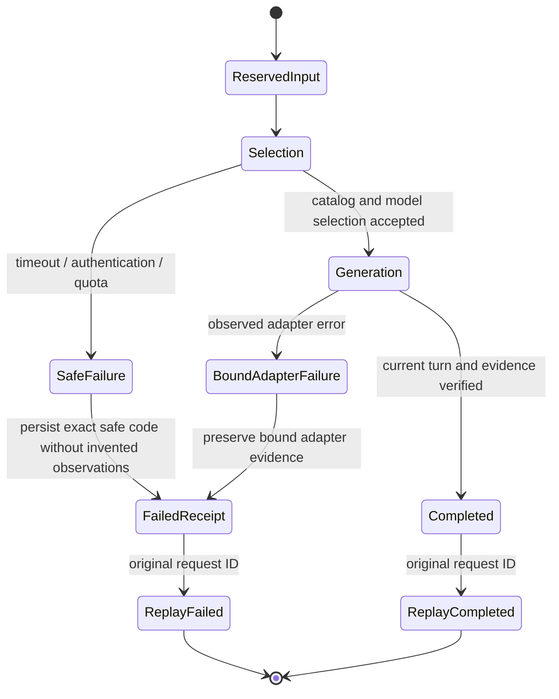

# Selection failure and durable input replay

The installed default-model catalog read timed out during an actual input
preflight. A subsequent bounded read recovered without restarting the shared
router. The raw timeout reached model selection before an adapter existed.
At that boundary the input path returned a generic failure, and an independent
installed-code regression reproduced loss of even a recognized error reason on
request replay: the initial receipt had the reason but durable generation
evidence did not, so replay omitted it.

The catalog now maps transport failures to bounded typed reasons: timeout or
connection failure to `routed_llm_unavailable`, HTTP401/403 to
`routed_llm_authentication`, HTTP429 to `routed_llm_quota`. It does not retain
provider bodies/URLs, retry, change the chosen model or treat a failed catalog
read as evidence about inference availability. The routed adapter also preserves
this reason if its own selection-stage catalog read fails before transport.

The input failure handler computes the safe code before persisting cancellation.
If there is no more specific bound adapter error, it retains only a code already
accepted by the generation metadata allowlist. It invents no selected/observed
model, response, usage, timing or verified context when selection failed before
an adapter existed. Existing sanitized adapter observations remain authoritative.
Unknown or decorated provider strings stay generic and are never echoed.

Failed-ID replay returns the original durable result; it does not select,
parse attachments, fetch links or generate again. Successful replay likewise
preserves the original receipt. The model setting, request identity, attachment
bytes and source references remain unchanged. No database schema change is
required and historical failed records are not retroactively rewritten.

This is a projection of the implemented control flow and bounded regressions,
not a theorem about all provider failures, asynchronous execution or OS state.
Tests cover both catalog reads, reason-specific replay, no generation after
selection rejection, no false provider-health write, and no secret/URL echo.

Separate installed-runtime verification used an isolated private conversation
store, the exact copied current Flash/high setting and the production abort
epoch. Synthetic image/text-file inputs, previous attachments, a public SQLite
page and its saved followup, cross-conversation isolation, completed replay and
late-response supersession all reached the actual selected routed model.
The supersession case holds a real provider result at an owned post-generation,
pre-commit barrier; it is not natural timing or a physical UI/gesture test.

These runtime results are task evidence, not checked-in source data or a broad
accuracy benchmark. The task's private reports retain original request IDs,
response stamps, bytes/digests and ledger readback. Native composer interaction,
physical voice, broad file formats/visual understanding, independent semantic
gold, actual backend reasoning effort and normal release remain distinct gates.
