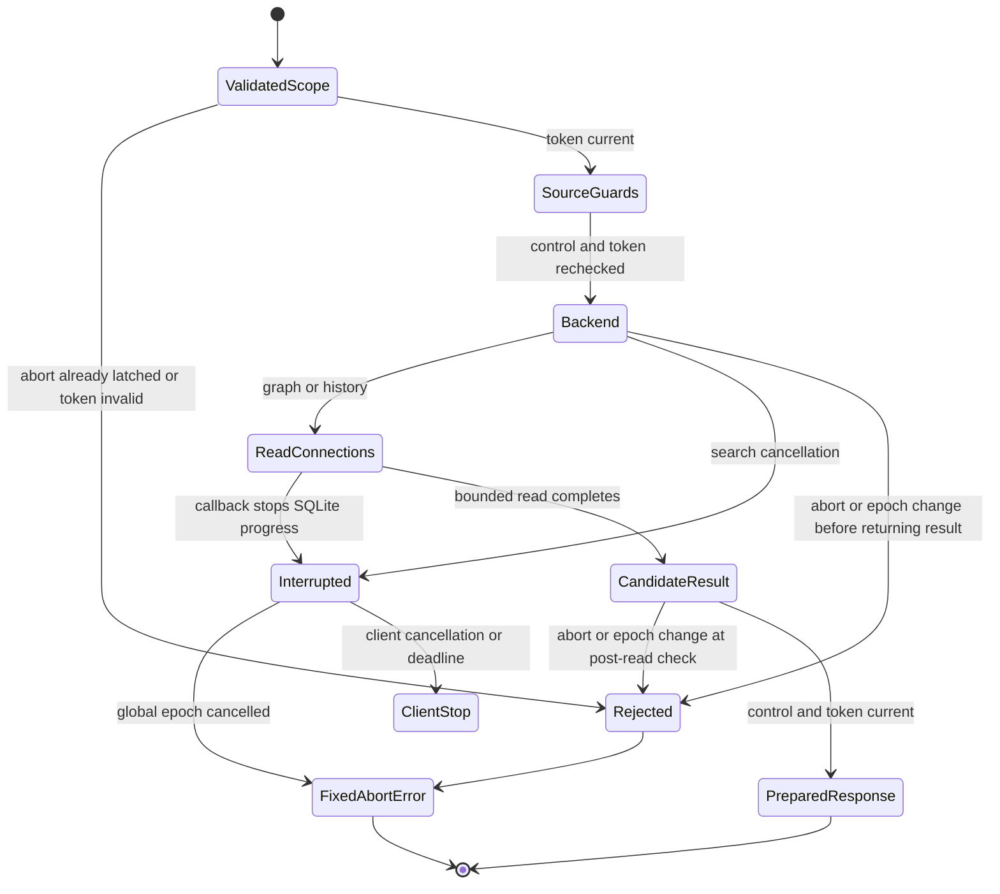

# Cancellation of scoped knowledge reads

The installed baseline returned graph and history payloads from a synthetic
collection while its global abort was latched. `CallToken` existed, but only search
received its callback; graph/history never checked it. Source authority and the
transport deadline are separate guards and did not close that gap.

`KnowledgeServer` now checks the client control and global abort token before
source guards, before backend entry, on backend failure, and after backend return.
Abort/resume changes the epoch, so an older request stays cancelled. A recognized
global cancellation becomes the fixed MCP tool error `alden_global_abort`.
Unrecognized exceptions still become `metadata_unavailable`; neither exception
text, request reasons nor private source content is included. Metadata-only status
remains available for diagnosis. Client control/deadline handling stays with the
existing stdio transport.

Graph/history pass a request cancellation callback through `read_action`. That
boundary owns a `ContextVar` scope, composes nested callbacks, and restores its
predecessor on success or failure. Nested read-only `CollectionStore.database`
connections inherit it and use the existing SQLite progress/cancellation handler.
Explicit connection callbacks compose with the inherited callback. Other workers
and later requests do not inherit a cancelled worker's scope. Writer connections
retain their existing explicit cancellation/publication contract.



This chart maps application checkpoints, not an atomic operation spanning the
SQLite read and stdout delivery. A cancellation arriving after the final check
can race with response serialization/delivery; this change does not prove an
all-process publication theorem or revoke bytes already delivered. SQLite checks
occur at the existing256-VM-instruction progress interval. Filesystem reads,
SQLite lock waits and pure Python work are not instantly preempted. No whole-app
latency, fairness or liveness result follows from these bounded tests.

The new regressions cover pre-latched stop of all three backends before per-call
source guards, abort/resume during each backend, unchanged client-control behavior,
a real recursive SQLite query interrupted before it completes, worker/next-call
scope isolation, and exception privacy. They use temporary synthetic stores and
fake backend callbacks; no real user abort file, source DB or model is modified.
The actual installed baseline also returned graph/history data in a separate
synthetic public-protocol probe. Broad affected tests include collection reads,
source authority, retrieval, snapshots, entity overlays, details and the existing
MCP transport deadlines/EOF/cancel contracts.

```sh
python3 -B -m unittest tests.test_alden_knowledge_abort tests.test_alden_knowledge_mcp tests.test_alden_status_mcp -v
```

The task-only integration decision remains separate. Installed Codex protocol
schemas expose no MCP/config setting on `thread/settings/update`; `thread/resume`
has a config field, and `config/mcpServer/reload` is a configuration-wide reload.
No resume, global config write or shared-server reload was attempted against the
active owner. Existing owned stdio reads remain authorized; persistent tool
registration limited to this live chat is unverified. The official App Server
documentation is https://learn.chatgpt.com/docs/app-server .

Source binding, original negative/positive logs, installed stdio checks and
recovery evidence belong in the task output `task-scoped-mcp-20261025`.
Current-source external Pro/Gemini/reverse review remains incomplete under the
preserved upload gate. These tests and the statechart do not replace that review.
