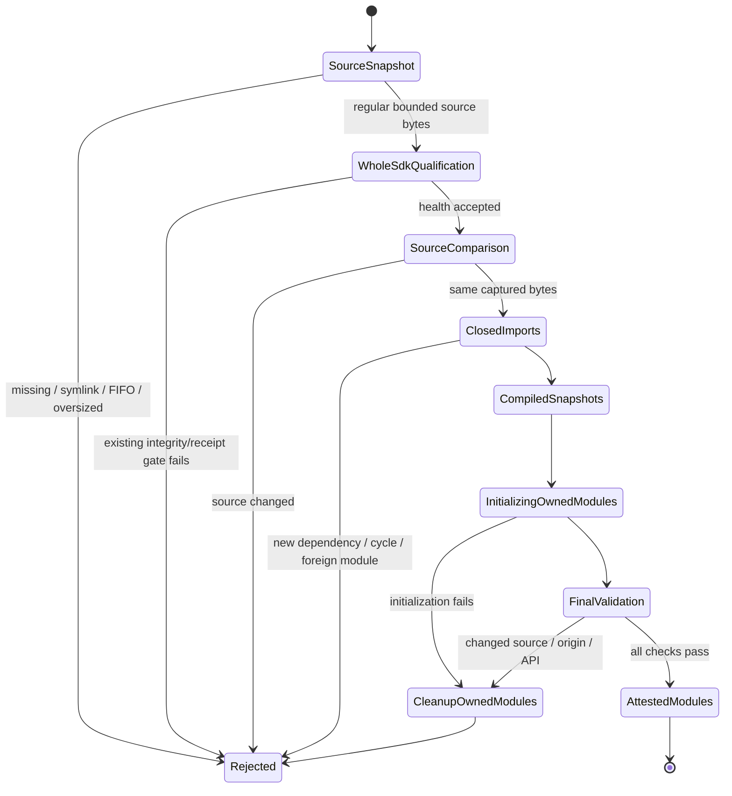

# Messenger SDK source execution and package completeness

The installed messenger factory could not import: the desktop resource list
omitted `alden_platform_identity.py`, which the runtime imports. The previous
dependency regression covered selected top-level imports but did not seed the
knowledge MCP entry point or traverse its conditional imports. The regression
now follows those paths and a separate isolated Python process imports the
staged messenger modules without a checkout, SDK load or native framework call.
The identity module is included in both desktop resource lists. The immutable
auto-reply worker does not import this messenger factory; its manifest and
activation/proof contract are unchanged.

An independent controlled test also reproduced a code-loader mismatch. CPython
`-B` disables cache **writes**; it can still execute an unchecked-hash `.pyc`.
The former loader hashed `.py` files and then used the ordinary import loader.
A fixture with a different harmless return marker in the cache passed its source
hash/origin checks while executing the cached code. This is a bounded regression,
not evidence of actual malicious SDK execution on the user's machine. The
current shared SDK's qualification failure prevents its production load.

The factory now snapshots the eight fixed source files with regular-file,
owner, size and no-follow checks. It retains the original all-SDK health gate
and requires unchanged source snapshots across that qualification. It analyzes
all local imports, including function-local imports, and accepts only the known
closed dependency set. It compiles the captured bytes directly, initializes
dependencies first, and never places the SDK directory on global `sys.path` or
invokes the ordinary bytecode-cache loader. Each file is bounded to 1 MiB.

Only modules created by this invocation are removed on failure; an existing
owner's modules are retained. Loaded attestations are published after source,
module identity/origin and API checks pass. A changed/deleted attested module
cannot silently reload. Dependency cycles are an explicit unsupported contract
requiring review. Cleanup is not a sandbox or a rollback of arbitrary module
side effects, stdlib imports or external writes. The approved SDK remains trusted
code; this change binds its executed Python bytes, not its publisher authenticity
or every native-library/filesystem race after a request has been delivered.

This diagram summarizes implemented transitions, not a formal proof of safety,
termination, operating-system permissions or message consent. Tests exercise
the old cache substitution, root and dependency caches, source changes during
qualification/initialization, initialization/API failure cleanup, foreign module
ownership, missing attested modules, unsupported cycles and unsafe file kinds.
Existing account/root/source-authority/cancellation and stdio MCP regressions
remain in place. Tests use private synthetic SDKs and harmless return markers,
never live messages or sends.

Current acquisition remains a separate unresolved requirement. The production
target registry has no native KakaoTalk/Telegram targets. The shared Kakao SDK
still fails its original whole-installation gate; source comparison of just the
reader's eight Python modules does not qualify the other skills or authorize a
global manifest rewrite. Telegram's probe still rejects the changed app/decoder
contract. Its context-specific consent and message visibility/expiry rules also
remain unchanged. No account switch, permission grant, source DB bypass, native
send, global SDK patch or production frontier activation follows from this fix.

Run affected checks with the pinned Python and `-B`. The existing CI factory and
launcher suites include these regressions. Actual bundle import, installed
resource hashes/signature, SDK gate readback, source qualification and eventual
live collection are distinct delivery evidence; local tests do not replace them.
