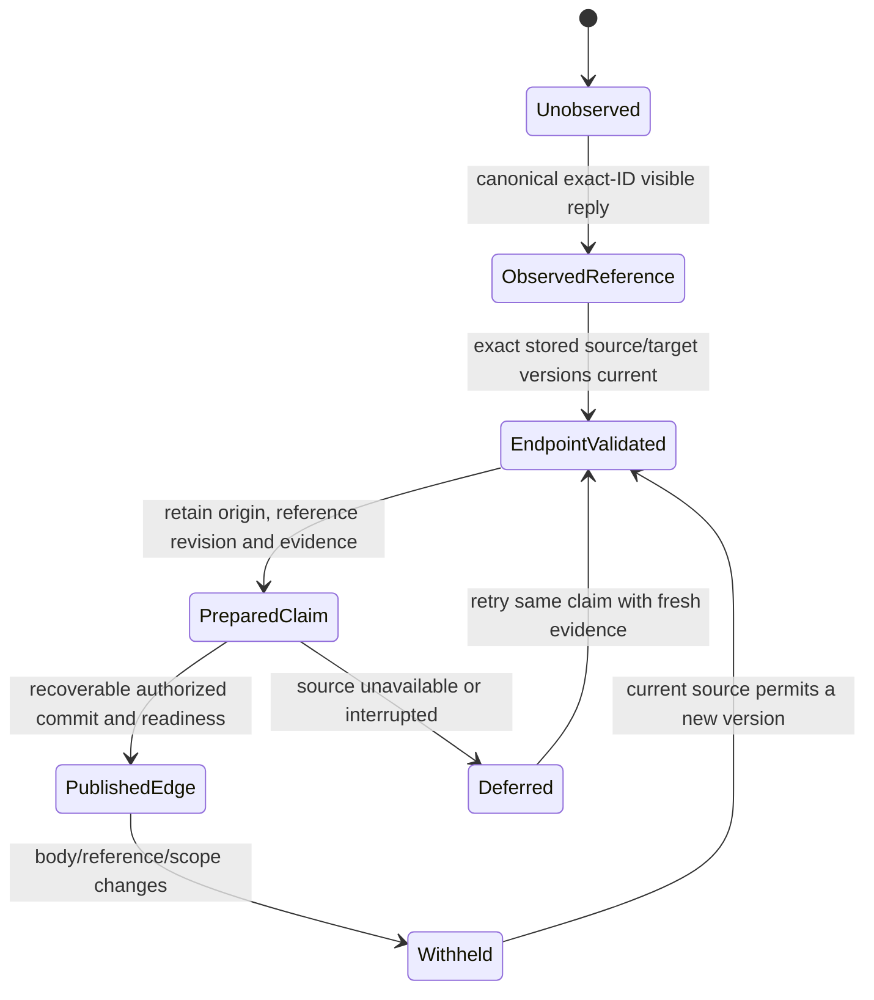

# Explicit messenger reference candidate

This follow-up is based on frozen integration source
`a0fde92e2f1f72effcadbc2571a2217c890c352b`. Its separate worktree preserves the
existing review packet, PR47, installed application and original collector.
The implementation adds current canonical reply-reference reads and atomic
manual claim/edge/history/refresh transitions with fresh read authorization.
Automatic reference-job scheduling and installed UI integration remain open.
This is a reversible candidate, not an installed or externally validated change.

## Observed gap

The actual private messenger graph contained407 nodes and zero edges. Ingestion
passes document candidates to `CollectionStore.ingest` without relations.
`KakaoReader.page` intentionally requests text without media metadata, so its
retained source rows cannot establish a structured reply. Neither the absence
of edges nor code26 alone proves the absence or presence of real replies.

Ninety-nine retained pages contained2,468 observations, including31 code26
observations and25 distinct room/message identities of that code. Their original
rows contained no media/raw-attachment fields. A bounded, latest-retained sample
of12 exact identities was reread through the existing verified canonical SDK.
All12 had visible same-room structured replies; two had substantive candidate
bodies at both ends and one had both document identities already stored.
This nonrandom sample is not all-room/history coverage or a quality precision
estimate. The counts describe observations, distinct identities and pairs
separately. No graph edge or source message was written to manufacture evidence.

## Current source observation API

`KakaoReader.reply_reference(room, message)` uses one exact-ID canonical snapshot
with media/raw metadata enabled. The SDK checks quoted-source visibility in its
same SQL transaction. The adapter validates account continuity, readonly/schema
and zero-side-effect receipts, exact room/message identity, a single complete
row, visible source body, eligible quote state, raw digest, JSON shape/duplicate
keys and positive ASCII source IDs within signed64-bit range.

Its verified output contains source/target message IDs, account/room binding,
the NFC source-body hash, attachment hash and a reference revision bound to all
these fields. It excludes source/quoted plaintext and locators. A changed
reference with an unchanged message body still changes `reference_revision`.
Withheld source/quote responses expose no source or target IDs. Noneligible
metadata is not admitted; a failed/invalid source response is not interpreted as
an empty successful relationship set.

The existing `page` and prepared-item formats remain byte-compatible. Their
recovery validator compares complete observed items; silently enriching those
items would strand already prepared pages. This additive API supplies explicit
evidence without changing that persisted contract or causing no-change pages to
emit new activity.

The reference observation does not establish a stored target version, semantic
agreement, quote-text fidelity or future visibility. Its original snapshot is
not atomic with later collection/frontier/relationship commits. Hashing and JSON
processing are linear in returned body/attachment size; raw attachment admission
is capped at262,144 bytes. One-row selection is not an all-source memory/latency
bound or proof that native content cannot change immediately after observation.

## Remaining publication and read contract

Do not publish a generic endpoint-only edge from this proof. A reply can change
its `src_logId` while both body hashes stay unchanged; existing endpoint body
checks would then leave an old relationship visible. The next implementation
must bind a durable claim to the exact origin and reference revision, revalidate
both current stored endpoint versions, retain history and withhold/revoke a
changed, missing or withdrawn reference. Duplicate content in another room is
not a substitute for the cited origin. Self-content references must not become
decorative loops or count as independent evidence.

Collection, frontier, claim readiness and UI are independent state owners. Their
commits must be recoverable and idempotent rather than treated as a distributed
atomic transaction. New/revised/retired relationships need an actual committed
refresh signal even when message body versions do not change. Policy replay,
unchanged state and permission waiting must not produce combat. Read failures
must retain queued claims/cursors, and late replies must respect current scope.



The current manual `reconcile` path implements origin/version-bound claims,
waiting for missing stored endpoints, publication, retirement and fresh read
withholding. Its claim, edge history and structural refresh event commit in one
collection transaction; no atomic transaction with original/frontier databases
is assumed. A failed commit gate rolls all three back. Automatic job scheduling,
fair retry and native UI delivery still require implementation/verification.
The architecture and material delta require current-source external cross-audit. Temporal
neighbors, similar force positions and shared vocabulary do not replace an
explicit reply, source citation, identity decision or semantic gold evaluation.

## Verification and actual limits

The focused adapter checks cover9 methods with controlled partial/failure inputs;
the related reader/frontier/production/factory run passed123 tests. Three
temporary actual-source variants admitting a different room, changed account or
withdrawn reply are rejected with assertion failures. Product files and native
sources are not mutated by those checks.

The actual new method reread the12 scoped native identities and matched their
previous source ID, attachment digest and NFC source-body hash. This is a
current read observation, not graph publication or an installed journey. Private
evidence is in task `outputs/messenger-relations-evidence-20261025/`; original
IDs/body evidence are excluded from external code packets. No default model,
SDK, permissions, original DB, sending queue or running owner changed.

```sh
python3 -B -m unittest tests.test_alden_messenger_references \
  tests.test_alden_messenger_frontier tests.test_alden_messenger_production \
  tests.test_alden_messenger_factory
```

## Manual publication and compatibility

`alden_messenger_references.reconcile` checks current source reference/body hashes,
both stored endpoint versions, pause/voice/abort/permission gates and the commit
guard. It preserves prior relation versions, retires changed references, emits a
real `relations_changed` refresh and treats unchanged replay as no activity.
No source body is added by this operation. A changed reference with unchanged
bodies changes the graph content token while preserving journal stream identity.
The graph and retrieval/MCP paths carry a separate relation-authority callback;
an explicit legacy endpoint-only callback cannot admit this new protocol.

The first persisted claim upgrades only that derived collection to format4,
retaining a verified private SQLite backup. Ordinary format3 roots remain3.
Format4 requires the exact protocol and claim-table shape, and current writers
preserve4. Older cold loaders that support only3 must reject it; hot old-client
fencing and original-process rollout need separate verification before any
production migration. Existing original installation/data have not migrated.

The source revision samples all known reference origins, including withheld
claims, so attachment-only changes can invalidate a view. Current correctness
uses exact canonical reference reads per origin. This is O(R) native observations
on top of the existing body checks and is not qualified for large source scope.
The existing100,000-origin admission ceiling applies; native batching, latency,
resource measurements and explicit coverage are required before promotion.

The controlled lifecycle tests cover publish/replay, same-body reference change,
withdrawal, temporary failure, pending endpoints, rollback/retry, pause/cancel,
changes during publication, opt-in schema/protocol validation, absent relation
authority, stored-version rebinding and mismatched callback roots. They are
finite actual-store traces, not a proof of every interleaving or all-input
correctness. Earlier raw receipts/counterexamples retain their original source
hashes rather than being relabeled as current verification.

Request cancellation is carried into automatically resolved production authority
and checked before/after canonical reference calls and between known claims.
The two-claim counterexample previously made a second reference read after the
first triggered cancellation; it now stops after one. A single blocking native
call is not thereby given a hard deadline. The caller's existing cancellation,
source callback ownership and commit guards remain separate checks.

Broader source coverage, automatic acquisition/retry, duplicate view-edge
projection, exact-cost measurements, native graph/UI, original production
installation and all main-goal release gates remain open.
