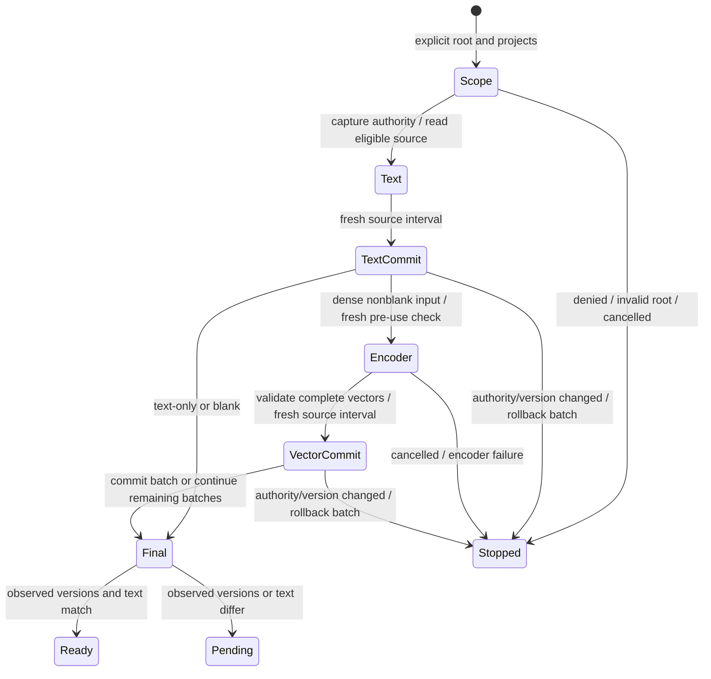

# Guarded index producer and native text boundary

Reversible candidate based on `30914b4bf37a48176da7880f70217a69fcc6e055`.
Installed Alden remains 0.3.218. Production enrollment, authority factory,
guarded standalone stdio, whole-corpus ingestion and external reverse review
remain open. This closes a demonstrated producer API gap within F-M08-01,
not the whole finding.

Later candidate: [readonly source loading and SQL cancellation](READONLY_HOST.md)
adds cancellable read/publication intervals and records the incomplete full-corpus
native run plus an actual independent stdio timeout/recovery journey. The839-check
and one-document receipts below retain their original source/workload scope.

## Observable defect and correction

`index_text` and `index_dense` opened CollectionStore without the explicit source
callbacks supported by retrieval/MCP. Protected messenger records were therefore
withheld even from an authorized producer; passing the callbacks raised TypeError.
Both producers now accept `source_access` / `source_revision` and forward them
through every store open. Their default remains closed for protected records.
Root ownership is checked before cache creation. No request JSON can mint these
trusted Python callbacks or enlarge the native source scope.

A connection-local source decision is insufficient across an encoder call.
The producer now captures the project's permission/source revision snapshot and
uses fresh source intervals before encoder input and around each cache transaction.
Each interval checks the captured scope and current selected document/version
memberships. The source connection's ordinary exit validation runs before the
outer cache transaction commits. Revocation observed during a write rolls that
transaction back. Reused vectors receive the same publication check. Cancellation
is checked before use, after encoding and inside vector publication.

The final metadata scan and fresh check of its versions precede `ready`/`pending`.
`ready` concerns the observed scope, not an atomic epoch shared by the collector,
native DB and index. A newly arriving source requires another index pass. Changes
after the final interval, downstream use, hostile trusted Python and permission
revoked between the last check and an external encoder receiving its input are
not proven impossible. Input already used by an encoder cannot be recalled.
Completed, previously authorized disposable cache batches can remain after an
error/cancellation; retrieval still checks current source/version authority.

Dense indexing does not probe/load an embedding service for an empty or blank
scope (`model: null`). Text-only retrieval checks that a vectors table exists
before probing a model profile. It can therefore search the text cache and return
source context while the embedding service is absent. No model fallback is added.

## State and actual-code checks

This chart describes observed code intervals, not a refinement proof or one
transaction covering independently changing components.



Nine new actual SQLite tests cover guarded text/dense/MCP composition, unchanged
vector reuse with unchanged source events, unguarded empty scopes without model
calls, cross-root cache rejection, post-scan and in-encoder revocation, cancellation,
version withdrawal, and native-authority revocation triggered inside each text/
vector SQL insert. The last two trigger cases check that persisted rows are zero;
an exception after an already committed write would fail that oracle.

All 839 affected checks passed in 45 fresh pinned Python3.11 processes. Five
isolated actual-source variants removing the source, pre-encoder, vector-write,
text-write and text-only-profile guards produce respectively 5/1/2/1/1 failing
assertions/subtests. No checkout/installed source was mutated. These are bounded
regression and mutation results, not a theorem about all interleavings.

## Actual native input

An explicit narrowing wrapper admitted exactly one retained Kakao document/version
and still delegated its current account/provenance checks to the canonical
Frontier/SDK. It did not grant other stored documents. The private retained store
has 18,661 distinct candidate documents; this test does not certify all of them.

The source passed text indexing, direct retrieval with current native context,
and an in-process MCP search with one fact in `bm25_only`. Four canonical reader
calls independently reported readonly/schema validation and zero source writes,
sends, settings writes and server calls. A network guard observed zero connects;
no embeddings or new models ran. The successful bounded run took 11.671 seconds,
including recovery validation and metadata work, not a user-facing latency sample.

Initial verification had two explicit harness failures: the MCP receipt was read
using an unsupported `structuredContent` field, and the first constructor added
an empty `activity_releases` table. The supported content JSON was then parsed.
Every pre-existing table matched its verified private recovery snapshot; the
exact empty schema addition was retained and separately recorded. The successful
run preserved both derived DB logical hashes from that accepted baseline,
including the prepared page and original journal. Original native DBs were not
changed. Recovery copies and all failed logs remain private.

Telegram's installed 13.1.0/283357 differs from the reader's qualified
13.0/283305 contract. Its metadata probe stops with
`telegram_app_changed_refresh_decoder_contract`; no Telegram bodies were read.
Qualifying that exact decoder/build and contextual participant consent remain
separate gates. A broad account request is not evidence of other authors' consent.

## Asymptotic cost and measured limits

Let N be eligible versions, P requested projects (at most16), R total project
permission rows, S selected permission rows, W encoder text windows, and M(K)
memberships of a K-document batch. The producer retains bounded source text and
version lists; existing limits are 100,000 versions and 32MiB selected text.
These are admission limits, not total RSS bounds.

Publication checks use candidate-key SQL, with at most256 document parameters per
query. They do not call the full `_index_rows` scan per encoder batch. Selected
membership ranking still pays for M(K), and native callback cost is additional.
The scope snapshot can scan R and sort S; without a project-leading registry index
one cannot call that operation constant-time as the target registry grows.
With fixed projects/registry and constant-time callbacks, the *added* batch guards
scale with selected memberships/windows rather than N times every batch. This is
not a proof of linear total indexing: existing full-project scans, FTS history
scans, sorting, raw blob I/O, multi-membership fanout and encoder work remain.

One fresh process per synthetic size, one sample, fixed one-project authority,
short unique-label records and fake encoder:

| Documents | Text seconds | Dense seconds | Replay seconds | Dense access callbacks | Process peak RSS MiB |
| ---: | ---: | ---: | ---: | ---: | ---: |
|128|0.0377|0.0998|0.0221|1,280|45.1|
|512|0.1209|0.3416|0.0901|5,120|50.4|
|2,048|0.3793|1.1926|0.1479|20,480|65.1|

Dense access callbacks were exactly10N in this fixture; source revision calls
were72/264/1,032, so a costly native revision callback can dominate frequent small
batches. These measurements establish a scaling baseline, not a speedup, a
confidence interval, an all-size bound or whole-app/native/GPU/battery efficiency.
The first 2,048-record fixture correctly hit the existing 2,000-record ingest
limit; it was corrected to512-record batches without increasing any limit.

## Reproduce and delivery gates

Run pinned Python with `-B`, one consumer test module per process. Focused entry:

```sh
"$PINNED_PYTHON" -B -m unittest tests.test_alden_messenger_authority
```

Private evidence is in `outputs/source-wiring-20261023/`: source SHA manifest,
isolated logs, real-source mutation logs, native recovery/receipts, scaling and
installed preservation. Public source bundles exclude all native content,
account/room identities, recovery DBs, session state and credentials.

The original reverse request `23126164b3bacc1c30f37598` and its immutable23fb packet
are preserved. This delta is prepared separately. The current shared ledger has
no free ChatGPT slot and another FIFO owner; this is not evidence of provider
liveness. No model substitution, duplicate send, priority override or extra paid
capacity follows. Current-source external validation, production wiring,
installation and all18/ST01–16/Cursor8 gates remain incomplete.
