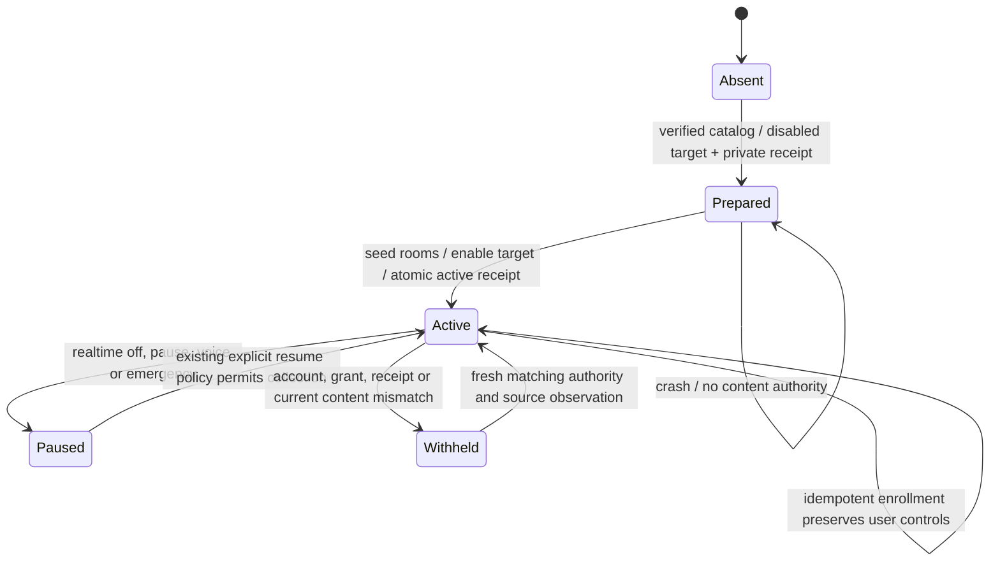

# Guarded production enrollment candidate

This delta connects enrollment, collection, text/dense producer entry points,
ordinary graph/history reads and request-bound retrieval authority to the shared
collection store. It is a source candidate. The installed app and production
registry have not been changed for this delta.

The current canonical Kakao SDK does **not** advertise the required content
revision batch. Native startup therefore returns
`kakao_content_revision_capability_required` before identity/body acquisition or
registration. This is an implementation prerequisite, not a request for more
user permission. Ordinary snapshot targets and the existing isolated evaluator
retain their contracts. Telegram enrollment is unsupported by this delta; its
decoder/account/consent holds remain in force.

## Storage and lifecycle

The explicit scheduler control operation `messenger-enroll` accepts only a
project list and requires the existing explicit opt-in. It uses the canonical
all-room catalog. Its private `production-messengers.json` receipt identifies
the platform, account, projects, generation and prepared/active state; it contains
no source credentials. The collection target must independently match that
receipt. Per-account frontier paths are derived from the account hash, preventing
a new account from reusing the previous account's frontier.

This is a review diagram, not a model-checker proof. Target registration, receipt
replacement, frontier commits, collection commits and activity release are
different operations. A crash after enabling a target but before the active
receipt leaves a prepared binding; readers and the collector reject it. An
explicit repeated enrollment resumes it without reading message bodies. An
already active enrollment never restores a user's disabled target, interval or
denied grants.

## Current source contract

The old authorization-only reader contract is insufficient for promotion:
stored body A can remain authorized after the source changes to B or becomes
withheld. The production authority therefore requires a fresh content-revision
batch, compares it with retained candidate origins and checks the authority
again before returning a graph/history/search response. The exact stored version
and its projection must also match. An origin that is now missing, hidden,
changed or unavailable cannot authorize the old body. Duplicate origins remain
separate; one still-permitted matching origin may authorize the same content.

Required canonical SDK interface:

- `snapshot.supports_content_revisions is True`.
- `snapshot(revision_keys=[{"room_id": decimal_string, "message_id": decimal_string}, ...])`
  with at most 8,192 distinct exact keys per call, isolated from ordinary lookup
  options. The SDK must validate the active account and fixed library, use one
  read-only snapshot transaction, preserve its current visibility SQL and never
  return body/attachment/author data through this operation.
- Success retains `db_readonly_verified` and `schema_decryption_verified`, with
  `revision_scope: "current-account-message-content-v1"` and exactly one
  `revision_rows` entry for each requested key. Each row has only `room_id`,
  `message_id`, `state`, and `content_hash`.
- `available` requires the SHA-256 of NFC source text, preserving source line
  endings. `withheld`, `missing`, and `unavailable` require a null hash. Ambiguous,
  non-text or over-budget input must remain explicit and cannot become visible.
- Hashing inside the canonical reader may read visible text internally. Its
  receipt must report that accurately; this is not the zero-body-read metadata
  projection. Hidden text must remain masked before Python receives it.

The authority batches origin checks and samples scope before/after the actual
collection read. This is a bounded consistency check, not an atomic transaction
across KakaoTalk, the frontier, the collection DB and the screen. A source can
change after the final observation; the live watcher and later reads must still
refresh it. The current SDK has not implemented or validated this interface.

## Scheduler and source ownership

The existing collection scheduler remains the cycle owner. Realtime polling
admits an enrolled target every five seconds only when realtime is enabled;
manual requests retain their explicit semantics. Each bounded cycle performs
four backfill steps, four live steps and one reconciliation step under the
existing frontier writer lock. It refreshes the canonical room catalog and
retains the independent per-room cursors. Static source capture is replaced by
the frontier's retained page/row provenance; existing indexing then runs with
the same source authority.

Existing pause, voice, cancellation, emergency, retry/backoff and publication
guards remain applicable. Device/reader authorization probes run before the
scheduler's abort commit lock; current local binding and target policy are
rechecked at publication. This does not prove a bound on all filesystem/SQLite
commit latency or on the existing scheduler critical section.

Four live steps per cycle are a bounded fair baseline, not a five-second latency
guarantee for every room. Catalog change hints, large backlogs, source revisions,
whole-app CPU/RAM and representative end-to-end latency still need native
measurement and optimization. No permanent additional watcher or model process
is introduced.

## Verification scope

`tests.test_alden_messenger_production` exercises the real store, frontier,
scheduler and read entry points using owned readers and databases. It covers
normal publication, replay, account/scope changes, current source edits and
withdrawal, malformed/absent revision results, a mid-read change, pause/voice/
emergency, backoff, scope revocation at publication, enrollment crash recovery,
explicit denial callbacks, ordinary-source isolation, and source probes outside
the commit guard. Existing messenger publication/fairness/recovery and collection
tests remain independent evidence.

The first fixture used macOS's `/var` symlink and was corrected to its resolved
private path. A later fixture wrongly treated collection disable as read access
revocation; it now preserves the existing distinction: deny permissions hides
content, while collection disable preserves currently authorized history and
blocks new publication. Neither correction relaxes the source guards.

The revision pass is currently O(C + B) work and memory for C retained candidate
origins and B text bytes. A pre-materialization limit of 100,000 origins and
32 MiB prevents unbounded allocation; exceeding it withholds content rather than
claiming completeness. These bounds are not a scalable final architecture.
Request-scoped candidate batches, native SDK implementation, representative
source/data readback and measured latency are required before promotion.

Current-source Pro/Gemini/reverse review remains NOT_RUN under the preserved
source-transfer rejection. This document and local tests do not replace that
review, native positive execution, installed UI verification or normal release.
