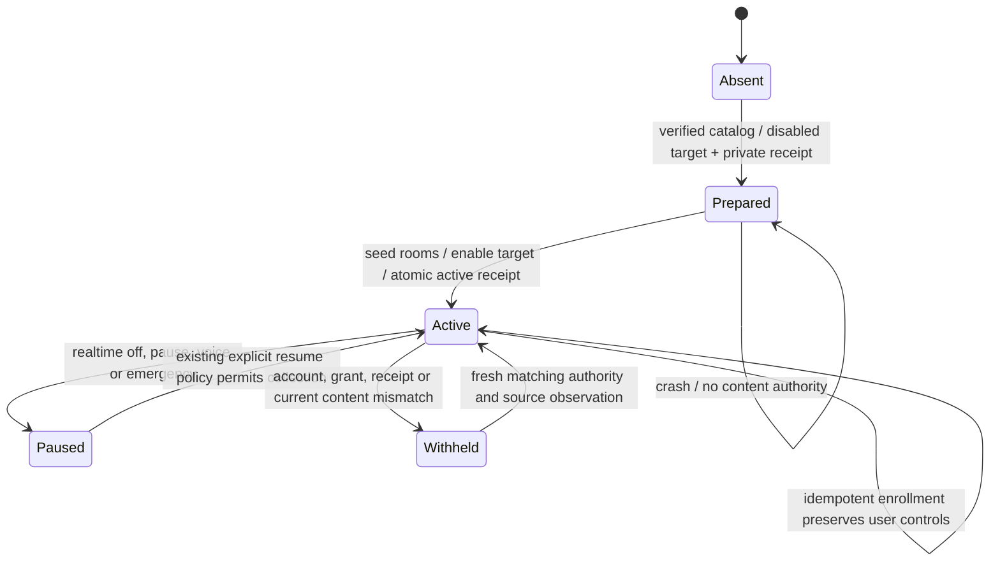
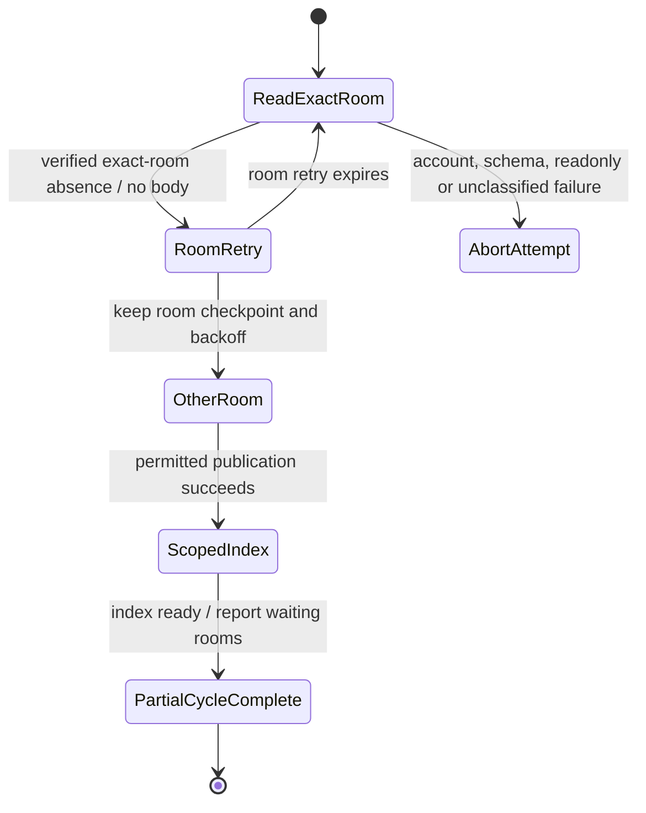

# Guarded production enrollment candidate

This delta connects enrollment, collection, text/dense producer entry points,
ordinary graph/history reads and request-bound retrieval authority to the shared
collection store. It is a source candidate. The installed app and production
registry have not been changed for this delta.

The locally reviewed canonical Kakao SDK now advertises the required content
revision batch. Its private manifest contains 136 files, with digest
`e4ae26c10e27d7f47eb4d947a4c7ca0c244ed5e5f1184f06d6f1573159f19b17`.
This is a qualified local extension; it does not claim a new publisher release.
Before that extension, actual candidate startup returned
`kakao_content_revision_capability_required` before identity/body acquisition or
registration. That negative receipt remains historical evidence. Ordinary
snapshot targets and the existing isolated evaluator retain their contracts.
Telegram enrollment is unsupported by this delta; its decoder/account/consent
holds remain in force.

## Storage and lifecycle

The explicit scheduler control operation `messenger-enroll` accepts only a
project list and requires the existing explicit opt-in. It uses the canonical
all-room catalog. Its private `production-messengers.json` receipt identifies
the platform, account, projects, generation and prepared/active state; it contains
no source credentials. The collection target must independently match that
receipt. Per-account frontier paths are derived from the account hash, preventing
a new account from reusing the previous account's frontier.

This is a review diagram, not a model-checker proof. Target registration, receipt
replacement, frontier commits, collection commits and activity release are
different operations. A crash after enabling a target but before the active
receipt leaves a prepared binding; readers and the collector reject it. An
explicit repeated enrollment resumes it without reading message bodies. An
already active enrollment never restores a user's disabled target, interval or
denied grants.

## Current source contract

The old authorization-only reader contract is insufficient for promotion:
stored body A can remain authorized after the source changes to B or becomes
withheld. The production authority therefore requires a fresh content-revision
batch, compares it with retained candidate origins and checks the authority
again before returning a graph/history/search response. The exact stored version
and its projection must also match. An origin that is now missing, hidden,
changed or unavailable cannot authorize the old body. Duplicate origins remain
separate; one still-permitted matching origin may authorize the same content.

Required canonical SDK interface:

- `snapshot.supports_content_revisions is True`.
- `snapshot(revision_keys=[{"room_id": decimal_string, "message_id": decimal_string}, ...])`
  with at most 8,192 distinct exact keys per call, isolated from ordinary lookup
  options. The SDK must validate the active account and fixed library, use one
  read-only snapshot transaction, preserve its current visibility SQL and never
  return body/attachment/author data through this operation.
- Success retains `db_readonly_verified` and `schema_decryption_verified`, with
  `revision_scope: "current-account-message-content-v1"` and exactly one
  `revision_rows` entry for each requested key. Each row has only `room_id`,
  `message_id`, `state`, and `content_hash`.
- `available` requires the SHA-256 of NFC source text, preserving source line
  endings. `withheld`, `missing`, and `unavailable` require a null hash. Ambiguous,
  non-text or over-budget input must remain explicit and cannot become visible.
- Hashing inside the canonical reader may read visible text internally. Its
  receipt must report that accurately; this is not the zero-body-read metadata
  projection. Hidden text must remain masked before Python receives it.

The authority batches origin checks and samples scope before/after the actual
collection read. This is a bounded consistency check, not an atomic transaction
across KakaoTalk, the frontier, the collection DB and the screen. A source can
change after the final observation; the live watcher and later reads must still
refresh it. The current SDK has not implemented or validated this interface.

## Scheduler and source ownership

The existing collection scheduler remains the cycle owner. Realtime polling
admits an enrolled target every five seconds only when realtime is enabled;
manual requests retain their explicit semantics. Each bounded cycle performs
four backfill steps, four live steps and one reconciliation step under the
existing frontier writer lock. It refreshes the canonical room catalog and
retains the independent per-room cursors. Static source capture is replaced by
the frontier's retained page/row provenance; existing indexing then runs with
the same source authority.

Existing pause, voice, cancellation, emergency, retry/backoff and publication
guards remain applicable. Device/reader authorization probes run before the
scheduler's abort commit lock; current local binding and target policy are
rechecked at publication. This does not prove a bound on all filesystem/SQLite
commit latency or on the existing scheduler critical section.

Four live steps per cycle are a bounded fair baseline, not a five-second latency
guarantee for every room. Catalog change hints, large backlogs, source revisions,
whole-app CPU/RAM and representative end-to-end latency still need native
measurement and optimization. No permanent additional watcher or model process
is introduced.

## Verification scope

`tests.test_alden_messenger_production` exercises the real store, frontier,
scheduler and read entry points using owned readers and databases. It covers
normal publication, replay, account/scope changes, current source edits and
withdrawal, malformed/absent revision results, a mid-read change, pause/voice/
emergency, backoff, scope revocation at publication, enrollment crash recovery,
explicit denial callbacks, ordinary-source isolation, and source probes outside
the commit guard. Existing messenger publication/fairness/recovery and collection
tests remain independent evidence.

The first fixture used macOS's `/var` symlink and was corrected to its resolved
private path. A later fixture wrongly treated collection disable as read access
revocation; it now preserves the existing distinction: deny permissions hides
content, while collection disable preserves currently authorized history and
blocks new publication. Neither correction relaxes the source guards.

The revision pass is currently O(C + B) work and memory for C retained candidate
origins and B text bytes. A pre-materialization limit of 100,000 origins and
32 MiB prevents unbounded allocation; exceeding it withholds content rather than
claiming completeness. These bounds are not a scalable final architecture.
Request-scoped candidate batches and representative scale/latency measurements
remain required before promotion. The native batch implementation and the
bounded positive source journey below now have separate execution evidence.

## Native candidate execution, 2026-10-25

### Subsequent room-failure isolation candidate

A verified `room_not_found` response previously aborted the entire platform
attempt before another room could publish or the normal index could run. The
scheduler then applied target-wide backoff to otherwise accessible rooms. A
second counterexample showed the same problem when recovering an activity
receipt after the frontier commit.

Only a native exact-room absence with read-only/schema confirmation and the
same current account now receives room-scoped retry. Its existing 60-second
room backoff and retained pages remain intact, while the bounded cycle may
continue other rooms and index their authorized records. The collection result
remains explicitly `partial`, including blocked-room counts; the settings
schedule displays those counts after a successful index. Attempt completion
means that bounded cycle/index finished, not that every room or its history was
collected. Global identity, schema, read-only, integrity and unclassified source
failures still abort the attempt. Absence is not used to delete stored originals
or release stale activity; current-content read authorization remains separate.

This chart describes sequential boundaries; it is not a proof of atomicity or
eventual availability. Owned implementation regressions cover one/all missing
rooms, independent publication/indexing, room recovery, pending activity,
unverified absences and account changes. A process-local broken variant removes
the scope distinction and is rejected by both original counterexamples. A second
variant labels global read-only failures as room-scoped and is also rejected.
The original source files are not modified by either negative control.

The signed candidate from `16e225b57467a0df83e93a4142e134a6ffe2814b`
then loaded the actual canonical SDK, confirmed the 372-room catalog, and took
the typed, verified absent-room branch for an exact ID absent from that catalog.
A normal native page still returned 50 rows. Its actual packaged menu dispatcher
queued a durable manual request into the existing private test root; collection
and the standard E5 index completed with 70 documents/vectors and 70 graph nodes,
with no activity generated by backfill. All 84 candidate files remained identical
and strict/deep signing passed. The original installed app's 83 files and running
collector identity remained unchanged. No original DB write, send or foreground
UI action was performed.

Local checks passed: 107 frontier/production/publication/fairness tests, a separate
84 collection/retrieval/menu regression group, 22 schedule UI tests, and the UI
build. Counts may overlap and are not a unique total. Mixed-room failures and
pending activity recovery use owned fixtures; no original DB was altered to
force them. Evidence is in the task's `outputs/messenger-room-isolation-20261025/`
(`native-readback.json`, `test-evidence.json`, both sensitivity receipts and
`preservation-readback.json`). Original production activation, installed UI
delivery, representative all-room live latency and external review remain open.

The native execution in the following historical section predates this room
isolation delta; its build revision is retained separately.

The signed candidate built from `fbad00f3f833054971c11d8696f0c4b67d8952b3`
loaded the qualified local SDK and read 13,310 exact, previously observed keys
in two native batches. It returned 13,218 available, 83 withheld and 9 unavailable
rows, exposing only the four declared identity/state/hash fields. The 198 rows
without a prior content identity are not edits; one non-null prior identity
differed. Source records, account identifiers and message bodies remain private.

Using its actual packaged menu dispatcher, the same candidate enrolled the
372-room local catalog into a new private production-style root. The original
production root and installed application were not changed. A durable manual
request completed native collection, retention and the normal E5 dense index:
29 documents, 29 vectors, no substituted indexer. Actual menu reads returned
29 graph nodes and 50 history items; standard hybrid retrieval returned two
current-source facts with valid provenance and two conversation-context windows.
These facts are source observations, not independently established truth.

An owned `--watch` process then completed two automatic native cycles, growing
the private root to 53 candidates/documents/vectors. The remaining observed
classifications were 466 context rows and one withheld row. All eight live
steps returned unchanged; the observed publications were backfill. The activity
feed remained empty, as required for backfill rather than simulated combat.
The owned process stopped gracefully with its stopped heartbeat; the original
launchd collector retained the same identity. No launchd installation, live send,
source DB write or foreground UI action was performed.

The current runtime integration head
`e78ea0a1cb0606fa08c320401d8f278ecad37913` passed all four CI jobs in run
[40135446094](https://github.com/twoimo/alden/actions/runs/40135446094).
The preceding run exposed five missing immutable-worker imports; their exact
dependency closure was added and the 13 packager tests passed. This did not
bake, activate or relax the supervisor proof of a live worker. The candidate app
remains bound to its build revision above, separately from the later CI head.

Private task evidence: `outputs/messenger-production-integration-20261025/`
(`native-pipeline-readback.json`, `native-watch-readback.json`,
`ci-e78-final.json`) and `outputs/kakao-content-revisions-20261025/`.
These bounded observations do not establish all-room history completion,
representative live latency, installed UI/combat delivery or whole-app resource
performance. The original installed Alden 0.3.218 remains unchanged.

Current-source Pro/Gemini/reverse review remains NOT_RUN under the preserved
source-transfer rejection. This document and local tests do not replace that
review, broader native execution, installed UI verification or normal release.
