# Messenger publication boundary

This reversible candidate addresses two reproduced defects in source7d7a514:
an activity reader could permanently consume a stored event between the store
commit and frontier commit, and `_source_access` accepted a non-current version.
It is uninstalled and has not completed current-source external cross-audit.

## Counterexample and rejected alternatives

Actual isolated SQLite trace before correction:

1. Prepare a source page and commit its document plus `stored` event.
2. Before the frontier commits its source heads, poll `activity_page`.
3. Source authority correctly withholds the body, but the cursor advances over
   the event. Committing/recovering the frontier creates no later event.
4. The client never receives that addition. The same loss survives a crash and
   restart; current-version mismatch also passed direct authority checks.

The original three executable checks failed. An initial candidate authorized
prepared pages whose store receipt was complete. It passed the activity checks
and a native six-document probe, but **failed the existing restoration invariant
that the body stays hidden until the frontier commits**. That candidate is
rejected. Its logs, source hashes and native receipt remain separately marked;
they are not final evidence for this implementation. A passing narrow probe
cannot override a stronger counterexample.

Changing the global stream generation on every source epoch is also unsuitable:
ordinary additions would reset to a snapshot and omit their pulses. This follows
from `activity_page`'s reset branch; normal additions must preserve generation.

## Owned state transitions

The collection and frontier databases commit separately. No distributed atomic
transaction is assumed. `activity_releases` belongs to the frontier owner and is
written atomically with its head/cursor commit.

```mermaid
stateDiagram-v2
    [*] --> Prepared
    Prepared --> StoredDeferred: collection commits original stored event
    StoredDeferred --> StoredDeferred: activity poll advances; no body or pulse
    StoredDeferred --> HeadCommitted: frontier atomically commits heads/cursor and pending outbox
    HeadCommitted --> ReadyRecorded: guarded collection transaction appends published receipt
    ReadyRecorded --> Settled: frontier marks outbox settled
    StoredDeferred --> PreparedRecovery: crash before frontier commit
    PreparedRecovery --> HeadCommitted: existing page/run is reconciled
    HeadCommitted --> OutboxRecovery: crash before readiness commit
    OutboxRecovery --> ReadyRecorded: source revalidation and same durable receipt identity
    ReadyRecorded --> OutboxRecovery: crash before outbox settlement
    OutboxRecovery --> Settled: existing published event is reused
    OutboxRecovery --> Deferred: source authorization/revalidation unavailable
    Deferred --> OutboxRecovery: bounded backoff; retain evidence
    Settled --> [*]
```



`published` means a durable refresh-ready receipt after the head commit. It does
not assert that a UI rendered, a client acknowledged delivery, dense indexing
finished or the content became verified knowledge. Stored changes remain counted
once; readiness is a separate stage. Older summaries without a `published` key
are accepted by the new UI with zero readiness stages.

## Invariants and limits

- A prepared page and even a completed collection run cannot expose a body
  before its source head is committed. Read authority binds the actual current
  target membership/version and matching source-body projection.
- New protocol pages mark their stored records `activity_deferred`. Those
  records never create visual activity. Normal non-deferred producers retain
  their existing behavior; old completed pages are not replayed as fresh events.
- A completed head commit leaves a durable pending outbox entry. A later
  `published` event refers to the exact original `stored_event_id`, run, target,
  document, version and change. Its stable event identity makes retries append
  no duplicate receipt. Original journal rows remain byte-identical prefixes.
- A failed release remains pending. Source failures use a separate outbox
  backoff rather than consuming another room's cursor or holding its retry gate.
  Permission and identity checks remain. Unchanged pages add no readiness event;
  policy-origin changes request refresh without combat items.
- Receipt identity is idempotent in the database. This does not prove exactly
  once network delivery, rendering, or unbounded liveness under permanent source
  failures. Queue size, old-source revalidation and backlog latency need separate
  representative workload measurements before production activation.

## Reproducible verification

From the checkout use the pinned Python3.11 runtime with `-B`:

```sh
python3 -B scripts/verify_alden_messenger_publication.py
```

Fifteen actual SQLite tests with controlled readers cover each commit/crash
boundary, restart, repeated cursor polls, deferred source visibility, wrong
version, source/account loss, checksum/body tampering, cancellation, independent
room progress, unchanged replay and preserved stream generation. These include a
check distinguishing full CRLF source identity from its LF search projection
through actual current-version retrieval provenance. Three temporary
mutations of actual source must fail: restoring premature stored activity,
omitting the durable outbox and bypassing the membership version predicate.
The checker never edits product sources. This is bounded generated/behavioral
verification, not a proof of the complete application or all source privacy.

A separate actual canonical Kakao probe discovered371 cached rooms, selected one
50-row page and read the private activity API inside the actual commit gap.
Before the head commit: zero heads, one prepared page, no visible source and no
activity receipt. After the head commit: six version-bound readiness receipts
for six added documents; a subsequent poll returned zero extras with the same
stream generation. Canonical reads verified readonly/schema and no server,
send, source-DB or app-setting writes. This is one isolated native boundary,
not installed combat, source-arrival latency, full history or native Telegram.

Private evidence: `outputs/messenger-publication-20261023/`. The native
`native-publication-receipt.json` belongs to the rejected alternative;
`native-outbox-receipt.json` belongs to this safe outbox path. Keep their source
hashes distinct. Legacy tests now require the original journal prefix to stay
unchanged and only its missing, exactly bound readiness receipts to append;
their original body-withholding checks remain.

## SQLite runtime qualification

The observed pinned menu runtime is SQLite3.46.0. The private collection database
uses WAL with `synchronous=FULL`; the frontier uses DELETE with FULL. These
process-crash/commit tests do not prove power-loss durability across every VFS,
filesystem or hardware configuration.

SQLite's official [WAL-reset advisory](https://sqlite.org/wal.html#walresetbug)
places this version in the affected range for a rare concurrent writer/checkpointer
race. A patched runtime qualification is a release gate; preserve active pins and
processes until compatibility, migration/recovery and installed readback pass.
No corruption was observed here, and this advisory does not establish the cause
of graph lag. Runtime evidence is `outputs/messenger-publication-20261023/sqlite-runtime.json`.
