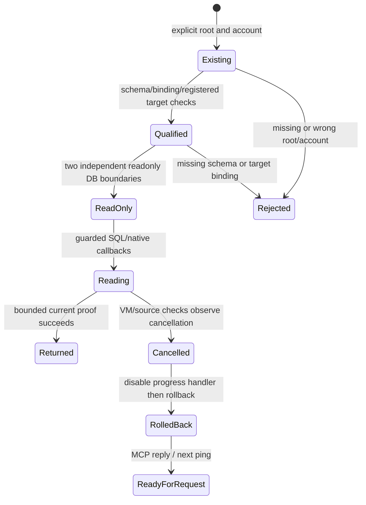

# Read-only source loading and cancellable collection reads

Candidate based on `40f151a229fa7856b1dca03b1e1dfa5d4ecf6990`. Installed Alden
remains0.3.218. This is progress on F-M08-01 and a locally discovered cancellation
defect; successful whole-corpus search/ingestion, production authority factory,
installed enrollment and current-source external reverse review remain incomplete.

## Existing state is loaded without migration

The old evaluation Frontier constructor runs schema/registration SQL. It had
added an empty `activity_releases` table during the prior nominal read probe.
That constructor remains the writer. New `Frontier.open_existing` checks an
explicit absolute private root/marker, existing regular nonsymlink source DB,
current account, one persisted account binding, required read/context columns,
existing collection and exact registered target platform/account/kind. It creates
no source directories, target, schema or migration. Missing state is an error.
Kakao/Telegram native decoder/visibility/consent rules are still delegated to
their canonical readers; this loader cannot qualify an unsupported Telegram app.

Frontier reads use SQLite `mode=ro` and `query_only`, with root/binding validation.
CollectionStore is independently opened read-only with source guards. A late
binding change is rejected. Current source-account/permission loss continues to
withhold graph data. Nested context reads preserve an already active read
transaction instead of executing a second BEGIN. The first readonly candidate's
actual duplicate-BEGIN failure is retained, not presented as a successful probe.

Four new real-SQLite tests cover retained schema, successful current context,
both DB write denials, missing frontier without directory creation, account/schema
qualification, unregistered target and late persisted binding change. Isolated
actual-source variants enabling frontier writes, enabling collection writes,
omitting binding checks or schema qualification are detected. Three produce
assertion failures; the writable-collection variant produces a wrong-exception
error (foreign-key failure instead of the required readonly denial). That error
is a detected boundary mismatch, not a passing writer test or source corruption.

## Long reads must observe cancellation

The full native workload exposed a second problem: `database(cancelled=...)`
checked cancellation only after executing the SQL and exit-time source checks.
A controlled recursive query executed all10,000 Python UDF calls after cancellation
was set on call3. A source callback was invoked again on connection exit after
the caller had already cancelled. The original two failing assertions are saved.

CollectionStore now installs a SQLite progress handler every256 VM instructions
when a cancellation callback is supplied. Native guard entry/exit checks observe
the same callback. The handler is disabled before rollback, preventing an
interrupted VM from interrupting its cleanup. Cancelled SQLite errors retain
their cause under `collection_cancelled`; ordinary errors remain specific.
Retrieval source scans and producer publication intervals forward cancellation;
retrieval keeps its public `collection_retrieval_cancelled` error contract.

Three regressions exercise actual SQL interruption/rollback, no native recheck
after cancellation, and cancellation through the real retrieval scan of301
protected documents. Removed VM interruption, source-check forwarding and
retrieval forwarding each cause one actual-source mutant test failure. A finite
VM interval is not a wall-clock bound: an opaque native/Python callback already
executing must return before cooperative cancellation can be observed.

All846 affected tests pass across45 fresh pinned Python3.11 processes. The earlier
843-check receipt and focused intermediate checks remain separate evidence.

## Full retained native workload: explicitly incomplete

The full existing Kakao evaluation project was attempted without document
narrowing, before the SQL-cancellation correction above. No new source acquisition
or graph activity was manufactured.
The existing180-second host budget stopped indexing. The trace records at least
32,768 source-access calls. The disposable text/FTS cache advanced from1 to7,425
complete rows; the last incomplete cache transaction was not published. There is
no ready receipt. The original `collection_source_authorization_changed` trace
is preserved: the host deadline gated its callbacks, so this is not evidence of
an actual native grant withdrawal. Already authorized complete cache batches
remain private for resumption; they were not deleted to make the run look clean.

Source/frontier logical hashes are unchanged after the run. Pages remain1,849
complete/one prepared, and the journal is unchanged. The32KiB cache recovery copy
is separately verified; prior source recovery snapshots are referenced rather
than copied again. The first preflight used Mac Python3.15/SQLite3.54 dump output,
which did not match the pinned Python3.11 serialization. A shell sequencing
mistake nevertheless started the first index process. Only that owned PID70488
was interrupted. Pinned reconciliation proved both source hashes unchanged and
cache still1row. The corrected preflight runs separately and must succeed before
index startup, which also verifies its private recovery receipt. All failed logs
and interruption evidence remain; no native DB/queue/runtime was reset.

Ten real retained-origin checks were profiled:0.068632s total (profiled
6.863ms/access), with real current identity checks and no native body acquisition.
The20 identity calls accounted for0.038429s cumulatively; canonical active-marker
parsing accounted for0.036013s. SQL execution and retained-page verification also
cost time. These are overlapping cumulative profile entries and must not be added.
This small profiled sample is not an end-to-end throughput estimate, a causal
speedup claim or permission to cache native identity/grants. Native corpus
throughput and cancellation overhead remain gates.

## Actual independent stdio process

An owned explicit evaluation host uses the readonly loader, real canonical Kakao
identity, unmodified KnowledgeServer and its actual pipe transport. This is
separate from the previous in-process one-document success. It does not register
a new production connector or silently discover/adopt an account.

The child served initialize, tools/list, rejected an unauthorized project and
JSON authority injection, then accepted a full-project search under the normal
10-second tool timeout. It returned `metadata_deadline_exceeded` after10.004s,
served a subsequent ping, and exited0 after EOF. It made951 source-access calls,
zero canonical body reads, network calls or embeddings. All six responses and
stderr are private. This proves the observed timeout/recovery path, **not**
successful whole-corpus search, current native visibility of every retained row,
installed factory wiring or a universal10-second callback bound.
The180-second index and10-second search are different operations/budgets and
cannot establish a before/after performance speedup.

The chart describes tested intervals, not a refinement proof or atomic native /
collection transaction. Full source visibility, authorization changes after the
last check, native callback preemption, successful whole-corpus latency and all
18/ST01–16/Cursor8 requirements remain open.

Private evidence: `outputs/readonly-mcp-20261023/`, including source hashes,
failed baselines,846 checks, seven actual-source variants, original/partial native
index traces, recovery/reconciliation, profile and real pipe receipts. Public
audit bundles include scoped full code/tests and these limitations, excluding
native content, account/room IDs, snapshots and session state. The original23fb
reverse request remains immutable; current deltas are prepared only. Current
external review, activation and release holds remain in force.
