# Watcher state and claim audit

The property is: temporary SQLite contention must preserve pending work and
return the real watcher to a fresh, bounded gate check. Unknown storage state
does not authorize a scan, acknowledge an input or mean that a source is empty.
Schema/corruption/programming errors remain errors rather than infinite retries.

## Source and actual counterexample

Coverage is `watch` in `scripts/alden_realtime_collection.py`, based on source
`1eb223652533fb47c66a8e888716c1088c134569`. The first check against that source
failed with an actual private SQLite exclusive lock at
`CollectionStore.open_existing -> SELECT meta`. The exception escaped the loop.
A separate authorized native history runner encountered the same exception kind
while its cancellation callback unnecessarily read the full scheduler status.
It stopped after 1,107 committed pages; one prepared page remained recoverable.
These are separate paths: repairing `watch` does not retrospectively repair or
complete the history runner.

The watcher now retries only SQLite BUSY/LOCKED codes (including extended codes)
after the existing five-second wait. It rereads policy/store/pause/abort/voice
gates. Its periodic-cycle invocation clock advances only after cycle return;
that return does not imply that collection or indexing succeeded.
Busy heartbeat storage is best effort; heartbeat failure supplies no source
authority. Other operational errors still propagate. Durable publication and
acknowledgement remain owned by the scheduler, not the watcher.

## State transitions

This diagram describes control flow, not additional persisted product states.
`storage_busy` is an internal heartbeat; the existing UI reports reconnecting.

```mermaid
stateDiagram-v2
    [*] --> Probe
    Probe --> Observe: enabled and current source/control reads succeed
    Probe --> DueCycle: live disabled and periodic cycle is due
    Probe --> Wait: live disabled and cycle is not due
    Observe --> Deferred: paused, emergency or voice active
    Observe --> Scan: current store and gates allow
    Scan --> DueCycle: input observations retained
    Deferred --> DueCycle: scheduler rechecks its own publication gates
    DueCycle --> Wait: cycle returns; invocation clock advances
    Probe --> Busy: SQLite BUSY or LOCKED
    Observe --> Busy: SQLite BUSY or LOCKED
    Scan --> Busy: SQLite BUSY or LOCKED
    DueCycle --> Busy: SQLite BUSY or LOCKED
    Busy --> Wait: retain unacknowledged work and invocation clock
    Wait --> Probe: five seconds; not stopped
    Wait --> Stopped: stop requested
    Probe --> Stopped: stop requested before the tick
    Probe --> Fatal: other storage error
    Observe --> Fatal: other storage error
    Scan --> Fatal: other storage error
    DueCycle --> Fatal: other storage error
    Fatal --> [*]: exception remains observable
    Stopped --> [*]
```



## Verification bounds and rerun

Run from the checkout:

```sh
python3 -B scripts/verify_alden_realtime_state.py
```

The pinned local runtime is Python 3.11.9; CI uses Python 3.11. The checker runs
the actual Python watcher, 84 deterministic BUSY/LOCKED boundary/control cases,
two disabled-live periodic retry cases, eight fatal-error cases and the real
private SQLite-lock/retained-input journey. Generated traces span two ticks and
inject one busy failure each. Progress assumes the lock eventually clears and
the process keeps running; perpetual contention has no completion guarantee.
An error after a partial cycle does not roll back its earlier committed stages;
their recovery and acknowledgement remain the scheduler's separate contract.
Controlled readers replace external boundaries; this is bounded generated-input
verification, **not a formal proof**, native messenger arrival test or complete
state-space proof. No TLA+/SMT verifier is installed or required by this check.

Two temporary mutations of the actual source must fail: restoring termination
on a BUSY error, and advancing the periodic invocation clock before a failed cycle.
The checker removes its temporary variants and does not edit product sources.
Current source must pass again. Mutation rejection is not mutation-test coverage
for the entire module. Reconfirm the source mapping after changes to `watch`,
the scheduler's publication gates, pending-input ownership or SQLite contracts.

## Claims that the evidence does and does not support

| Claim | Decision and evidence boundary |
| --- | --- |
| Exact duplicates identify the same person or independent corroboration | Reject. Full NFC equality identifies only a content key; distinct original room/message IDs remain. Repeated origins can be copies. |
| Search projection bytes must equal original bytes | Reject. The original NFC content key retains line endings; the searchable projection additionally normalizes CRLF/CR. Original blobs/pages are retained and hash-verified. The actual audit found 28 such projections. |
| Lexical candidate classification proves useful or true knowledge | Reject. Every current candidate is explicitly `unverified_candidate`; semantic novelty, contradiction, authorship and temporal gold remain open. |
| A bounded test or state diagram proves the whole project | Reject. These checks cover listed source/bounds only; external processes, hardware, source visibility and install gates require separate evidence. |
| A force layout proves semantic equivalence or global optimum | Reject. The bounded layout solver is a visualization heuristic; proximity and forces cannot authenticate a claim, identity or relation. |
| One live sweep proves real-time arrival latency | Reject. Arrival-to-store-to-index-to-graph latency needs a timestamped actual source event and the installed path. No message was injected. |
| A fresh account check proves all retained source bodies remain visible | Reject. Account binding and body visibility/consent are independent gates. Retained-store checks do not prove current native visibility. |
| Source/CI success proves installed behavior | Reject. Installed Alden remains 0.3.218/runtime42c648e; this source candidate is uninstalled and externally unvalidated. |

The audit follows the scoped-property, broken-variant and honest-bounds contract
in the official [pstack formal-verification guidance](https://github.com/cursor/plugins/blob/main/pstack/skills/create-formal-verification-skill/SKILL.md).
It does not certify all Alden mathematics or discharge the full 18/ST/Cursor goals.
