# Stable activity identity and current content refresh

The ordinary production reader used its strong current-content revision as
the activity namespace. Adding a message changed that revision and therefore
the stream ID. A consumer polling from its earlier cursor received `reset=true`
and no receipts, even when the exact new live message had been committed and
released. The integration counterexample reproduces that lost notification.

The production authority now supplies a separate `stream_revision`: enrollment
generation plus the existing account/room authorization, project permissions and
quality-policy scope. It remains stable when message contents grow within that
scope. Account/scope or journal replacement/rewind still requires a new baseline.
The existing `revision` remains a fresh batch of original content hashes; it
continues to guard every protected record and verify the read before completion.
Both callbacks are bound to the same declared state root. An unavailable or
malformed stream authority withholds protected records.

The graph/activity checkpoint additionally carries an opaque `content_revision`
when protected sources participate. A changed body, withdrawal or source failure
can change this token without replacing the journal. The UI requests a fresh
graph but preserves valid pending receipts. It displays a pulse only after the
current graph's token, document version and target match the receipt. Old
snapshots and partial responses cannot drop a declared content-token contract;
first adoption fences an older in-flight response. Hidden, stale, failed,
duplicate and expired activity keeps its existing handling and resource bounds.

| Change | Journal identity | Content token | Consumer action |
|---|---|---|---|
| New committed message in existing scope | Stable | Changes | Read receipt; refresh graph; match before effect |
| Original body changes before collection | Stable | Changes | Refresh/withhold stale content; no invented event |
| Account, permitted scope or journal changes | Changes | May change | Clear effects and establish baseline |
| No source/collection change | Stable | Stable | Preserve cursor; no activity |

Explicit legacy callbacks retain their old contract unless a separate stream
callback is supplied. Ordinary unprotected sources need not declare a content
token. New source fields are additive; this is not an atomic transaction across
the original database, frontier, index and collection store. Room-scope changes
may conservatively replace a baseline. Timing, source availability, refresh and
the existing effect TTL remain liveness conditions.

Tests cover delivery of a committed live addition, body changes without a new
journal event, account changes, foreign/invalid stream callbacks, strong content
withdrawal, pending snapshots, delayed polls and protocol adoption/downgrade.
Process-local variants that restore the data-bound namespace or weaken the
content guard fail their respective original counterexamples and pass after
restoration. These are bounded implementation checks, not a general proof.

## Correction to earlier activity evidence

An initial activity read without `after` is always a baseline: it intentionally
returns no items. Earlier private native receipts reporting `activity_items=0`
and the scheduling comparison's initial activity response were such baseline
reads. They do not prove that no readiness records existed, that backfill was
filtered, or that real combat had been exercised. Their raw receipts remain
historical evidence; their interpretation is narrowed here.

First-time backfill and live ingestion retain their actual `origin` values.
They must be distinguished when reporting source behavior; a first successful
stored change is not an idle/decorative event. Policy reprocessing stays a refresh
signal rather than a pulse. Current native incremental validation must establish
a baseline before collection, poll with the exact cursor/stream, and inspect
committed origins afterward. Original installed UI/combat and external review
remain separate gates.

## Concurrent read failure and cursor recovery

An actual private-root native observation at runtime source
`c0ddb9c41a501c3a41e09cc45ac74715f0700e3c` reproduced
`collection_source_authorization_changed` at the final strong-content check in
`CollectionStore._install_source_access.verify`. A content revision changed
while the read was in progress. The exception withholds the response; it is
not an accepted empty page or a reason to advance the client cursor. The next
poll retained that cursor and succeeded. This identifies the new observed
failure, not retrospectively the unrecorded reason for the earlier RuntimeError.

```mermaid
stateDiagram-v2
    [*] --> WaitingPoll
    WaitingPoll --> Reading: request committed cursor and stream
    Reading --> Rejected: final source revision differs
    Rejected --> WaitingPoll: keep cursor; bounded retry delay
    Reading --> AcceptedPage: source checks stable and page contract valid
    AcceptedPage --> WaitingSnapshot: commit cursor; retain eligible receipts
    WaitingSnapshot --> WaitingSnapshot: older or mismatched graph
    WaitingSnapshot --> Emitted: current content, target and version match
    WaitingSnapshot --> Discarded: expired, hidden, withdrawn or scope reset
    Emitted --> WaitingPoll: subsequent pages do not repeat seen receipt
    Discarded --> WaitingPoll
```



This is a review surface over independent backend and frontend transitions.
There is no single transaction from the original database through collection,
network and UI. The backend read transaction and its end-of-read verification
are distinct from receipt delivery, client cursor adoption and graph refresh.

| Boundary | Actual code | Checked promise |
|---|---|---|
| Source changes during read | `CollectionStore._install_source_access` / `database` | No response escapes after its final source check detects a change |
| Authorization and content | `ProductionAuthority.stream_revision` / `revision` / `access` | New content does not reset the namespace; stale body remains withheld |
| Same-cursor retry | `read_action` / `activity_page` | A rejected read does not consume the later eligible receipt |
| Client failure and snapshot | `CollectionActivity.tick` / `snapshot` / `flush` | Retry starts from the old cursor; an eligible receipt emits once after a matching snapshot |

Use the existing project test infrastructure:

```sh
python3 -B scripts/verify_alden_activity_stream.py --output /absolute/private-output/stream.json
cd desktop
npm test -- src/__tests__/collection-activity.test.ts
```

The backend checker runs three controlled real-store cases, then rejects three
process-local mutations: data-dependent stream identity, authorization-only
content checks and a missing final read check. It restores the original methods
and reruns all three cases. Exact covered-file hashes, HEAD and dirty paths are
recorded; product sources are never rewritten by the checker. The added retry
case has two rooms, three message identities, one live addition, one withdrawal
during reading, one retry and one repeated-cursor read. This finite trace is not
an enumeration of all interleavings, a refinement proof, all-input correctness or
unbounded liveness. The UI check uses its existing fake transport/clock and makes
no native rendering or real-message-arrival claim.

The new native window completed three automatic collection/index-ready cycles,
with166 unique incremental receipts, all explicit backfill origins, no duplicate
IDs and no namespace reset. Its eight activity reads had seven successes and
one guarded exception; all four100-node graph reads succeeded. Activity median
was0.457s and graph median1.342s on this small concurrent private workload.
There is no matched earlier workload, whole-corpus measurement or speedup claim.
A fourth attempt was interrupted by the owned graceful shutdown and retained
`messenger_request_cancelled`; it is not a fourth completed cycle. The original
collector and installed application were preserved. Source DB writes, sends and
foreground UI actions remained zero.

Evidence: task `outputs/messenger-concurrent-read-20261025/`, separate from the
earlier native watch and its unresolved error reason. The current-source
external review packet still binds the earlier exact runtime snapshot; these
tests/docs do not retroactively change its hashes or establish provider access.
