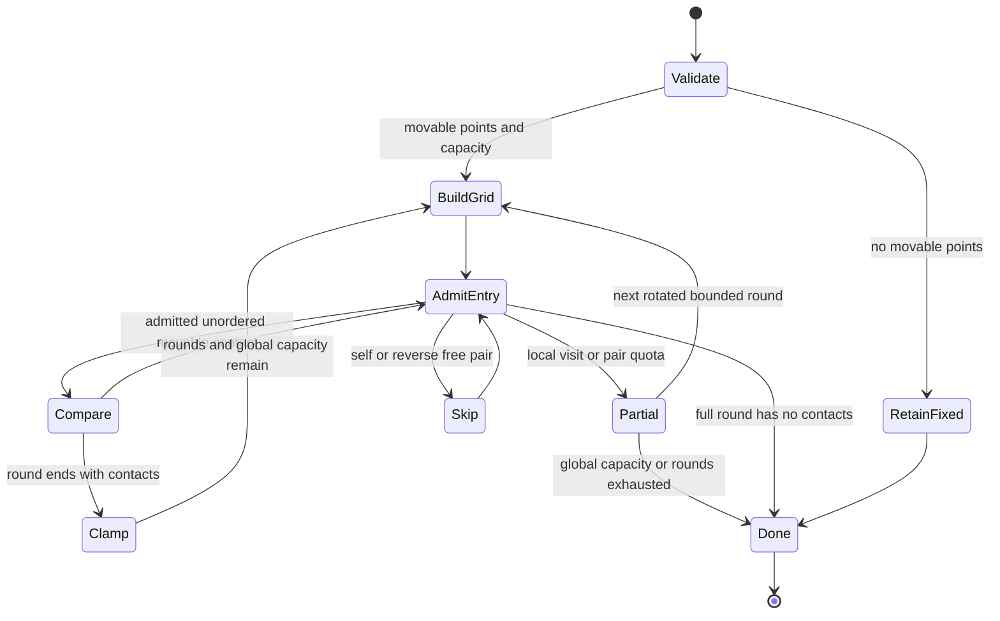

# Projected work admission and state transitions

Baseline9a723050532432f57e9afdf0f24a80f96427b1b3 had an arithmetic pair cap but
no candidate-entry cap. A source-bound observer with exactly equal output offsets
measured8,388,608 entries with2048 fixed points and29,347,842 with2046 fixed points
and2 movable points. The latter performed only22,508 distance tests. These are
synthetic helper states; the installed overview normally has at most one focus pin.

Pin membership is now snapshotted once per active point. Only movable points query
neighbor cells; free/fixed pairs are still processed regardless of index, while
fixed/fixed pairs require no query. The coincident-pair seed uses ordered indices
and an antisymmetric sign so reversing the free/fixed query retains its direction.
A cell entry is admitted *before it is read*, including self/reversed entries.
Candidate524288 and arithmetic131072 ceilings are independent.32 core rounds may
use remaining capacity, with optional whitespace restricted to the first8 rounds.
The node2048 and display-shift10px ceilings remain unchanged. No saved coordinate,
relation, semantic force, title, identity, index, embedding or model changes.

The diagram describes control states, not a model-checked GUI proof. An exhausted
prefix with no contacts is not evidence about an unvisited suffix; it must not be
used as convergence. A private constant64 witness catches the previous break:
correct code visits64 entries and moves the coincident pair; the break mutant
stops at2 entries without moving. Disabling the visit guard produces66 and is
rejected. The default524288 guard mutant reached473689 on the selected dense
workload and was **not** rejected; that result is retained, not counted as full
mutation coverage. An observer after the admission guard exactly matches the
counter and leaves output offsets unchanged on all three selected pin regimes.

Resource argument: letN≤2048, P≤32, G≤8, V≤524288 and T≤131072. Counters start at0.
Every admitted increment follows a remaining-capacity check, and local quotas are
at most the remaining global capacity. Induction over admitted entries/pairs
therefore preservesV/T ceilings. At mostP+G grids are built, at most9(P+G)N neighbor
lookups and(P+G)N grid-insertion lookups occur (10(P+G)N Map reads
in total), and the active/fixed/update arrays requireO(N) memory. Candidate
loop work is bounded byV rather than an uncounted quadratic suffix. This counts
operations and does not establish worst-case JS Map latency, allocation/GC time,
OS scheduling, primary UI latency, GPU/FPS or battery. Spatial pruning alone is
not a universal linear-time theorem for arbitrary graph sizes or caller policies.

Offset projection still enforces norm≤10px on finite admitted inputs; valid fixed
prior offsets remain fixed under the existing cap. No theorem says every dense
packing can separate. For2048 equal radius1.6 circles with coincident original
centers and center displacement≤10, disjoint cores would require
`2048*(1.6²) ≤ (10+1.6)²`. The left side5242.88 exceeds134.56. This necessary area
condition alone proves zero overlap impossible for that fixture; it does not
prove sufficiency for any other packing or semantic/entity correctness.

The three new regressions fail on the baseline. Full frontend1155 checks in103
files and TypeScript check pass. CPU comparisons use ordinary Set,3 warmups and21
alternating measured rounds. Synthetic all-fixed p50 31.038→0.120ms; two-movable
145.157→0.938ms. A free coincident stress case5.285→5.912ms and core overlap261392→
261679 are retained. Saved already-corrected native points used as fresh inputs
show7.494→4.001ms(default) and5.729→4.454ms(compact). These are separate solver-only
cohorts, not a production raw-input or universal speedup claim. Existing native
core residuals5 have penetration0.0005–0.153px; they are not removed by tolerance.
New canonical native/install results live under the task's projection-budget-
20261025 evidence, rather than being inferred from these CPU tests.

Current-source external Pro/Gemini/reverse verification remainsNOT_RUN under the
preserved upload rejection. Original tabs/jobs, exact requested model constraints,
shared SDK/runtime pins, production queues and normal release/notary holds remain.
