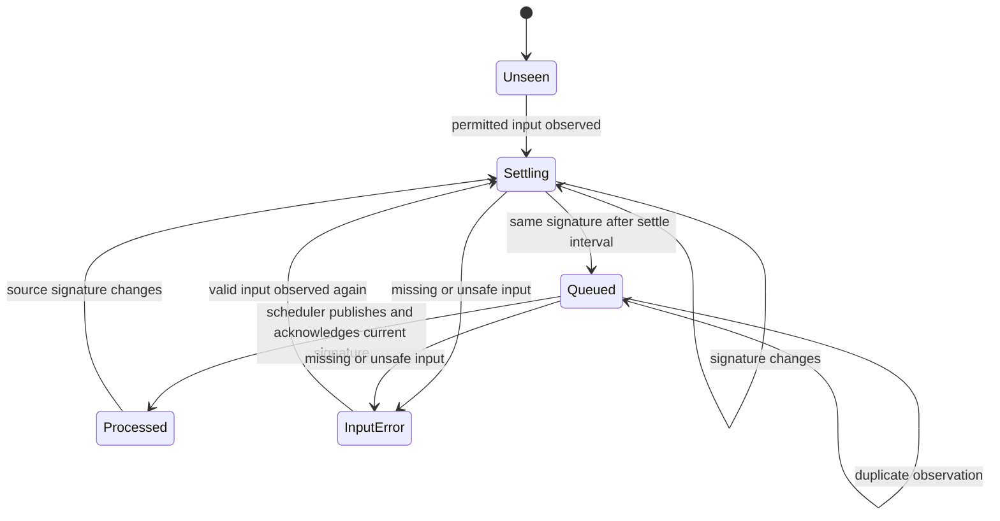

# Realtime target coverage beyond the first 200

The input watcher repeatedly selected the first 200 eligible target IDs. With 201
permitted, enabled targets, the last target was never observed by this watcher,
even after its source changed. Its ordinary collection schedule could still run;
this defect concerns input-triggered collection, not all collection.

`RealtimeCollection.scan` now walks keyset pages of 200 IDs, committing each page
before continuing. It releases the collection-store read before inspecting files
or writing observation hints. The page size limits temporary ID storage rather
than the supported target set. Existing debounce, coalescing, acknowledgement,
permission, pause, and scheduler publication rules remain in place. A changed
live-policy revision stops traversal before the next page.

This diagram describes existing observation states, not an implementation proof.
For a fixed eligible registry, the cursor advances past a page only after that
page's observation transaction commits. A later failure leaves earlier pages
durable and the next watch tick starts again from the beginning. Registration or
permission changes during traversal do not have a single snapshot guarantee;
later ticks reconcile them. Scheduler publication gates remain authoritative.

For N eligible targets, a complete unchanged-registry, unchanged-policy pass has N
eligible ID visits (paused inputs may be skipped) and `ceil(N/200) + 1` page queries,
including the terminal empty query. Each observed target
also performs its existing target lookup, permission lookup, file metadata checks,
and realtime-state lookup/update. At most 200 IDs are held in the scan's page list.
This is not an O(200) memory claim for the entire watcher: `pending()` and scheduler
candidate collections still grow with their respective target sets. There is no
fixed elapsed-time or arbitrarily large-scale realtime guarantee. No production
speedup, FPS, RAM, or battery improvement is claimed.

Validation uses isolated real SQLite stores and files with a fake dense index:

- 401 eligible targets span three nonempty pages. The last target publishes its
  first version, detects another source change, publishes a second version, then
  remains acknowledged without requeue. Other pending hints and all intervals are
  preserved.
- A 203-target fixture excludes disabled, denied, and paused targets, including
  traversal beyond the first page.
- A controlled policy-revision response stops before page two; a subsequent
  normal pass resumes and settles all 201 inputs. This policy-boundary test is
  synthetic, not a concurrent OS-policy proof.
- The realtime collection, watch-state, and scheduler suites pass 46 tests.
- The final 401-target regression run with the exact installed scanner method
  fails with `200 != 401`. This negative control uses isolated candidate fixture
  dependencies; it does not execute a production collector or alter installed
  bytes.

The actual installed app has 43 declared/eligible targets. A read-only observation
found 43 realtime inputs, no input errors or queued hints, and a fresh heartbeat
from its existing collection process. Its separate OSK producer checkpoint was
older, with `collection=pending` and `saved_corpus_ready=false`; the primary GUI
process was not running. The source shows OSK synchronization belongs to the
desktop process, while the launch agent owns collection watching. This separates
the two observations; it neither proves why the GUI exited nor identifies this
200-target defect as the cause of that stale checkpoint.

This is an uninstalled candidate on frozen source
`3407c08e8e3bdf14b378735bb7048e4398dbaede`. Current-source external review,
integration with the other candidates, canonical build/sign/install, native
background QA, and production-source observation remain separate delivery gates.
