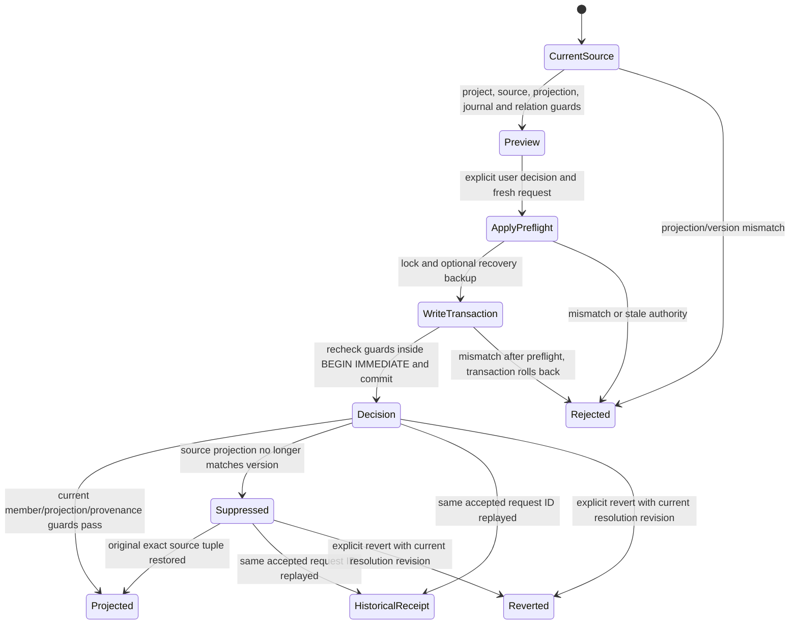

# Version-bound duplicate-resolution overlays

A source/member fingerprint can consistently describe bytes that were already
corrupted before a review started. Before this change, a changed stored body could
receive a fresh preview and an accepted display-resolution decision under the old
version ID. Changing only `projection_sha256` could also leave an active overlay
projecting as current. Both failures were reproduced through the public
`resolution_action` API in an isolated synthetic store; no production source was
changed. Three new regression methods failed in seven subcases on the baseline.

`alden_entity_resolution._source_rows` now checks the same v3 construction as the
source-detail reader: SHA-256 of the exact stored label, body and metadata excluding
`source`, followed by the version identity derived from document ID, raw digest,
processing version and that projection digest. It validates the digest and version
before returning a preview, on apply preflight, again inside `BEGIN IMMEDIATE`, and
when testing the validity of an existing overlay. The new failure is
`collection_resolution_projection_integrity`. Existing raw-record, project/native
permission, journal, member, relation, revision and request-ID guards remain.

The safety promise is that a mismatched v3 tuple cannot produce a new accepted
preview/decision or a currently projected overlay. It is not semantic duplicate
classification, database authentication against an attacker who rewrites all
supporting state, or a proof that accepted facts are true. Migrated `legacy` rows
with an empty projection field retain their existing compatibility contract; their
v3 projection integrity is unavailable. Mixed legacy/nonempty-projection fields
are rejected. No old source, version, decision, schema or receipt is rewritten.



The chart projects separate code boundaries; the preflight and backup are not
atomic with the write transaction. The late-change regression mutates only the
synthetic projection field after preflight/backup, then reaches the actual second
guard inside the write transaction. No feature tables or decision survive that
rejection. Another regression restores the exact synthetic field and verifies that
the same original decision becomes eligible without a second apply. Request replay
returns a historical receipt and does not reactivate an invalid projection.
Changing metadata's intentionally excluded `source` field still changes the member
fingerprint, so stale plans remain rejected while fresh legitimate previews work.

This is bounded real-code regression evidence, not an exhaustive model check,
all-input theorem, liveness/fairness proof or whole-project correctness result.
The affected tests also exercise apply/revert/replay, project unions, permissions,
source/edge preservation and quality comparisons. Relevant command:

```sh
python3 -B -m unittest tests.test_alden_entity_integrity tests.test_alden_entity_resolution tests.test_alden_entity_projection tests.test_alden_entity_union_review tests.test_alden_graph_quality_action -v
```

Current-data observations, source hashes, exact negative/positive logs, installation
and runtime readback belong in the task's `outputs/graph-current-integrity-20261025`
delivery. No semantic grouping or production merge follows from the read-only
audit. External current-source Pro/Gemini/reverse review remains incomplete under
the preserved upload gate; local tests and this chart do not replace it.
