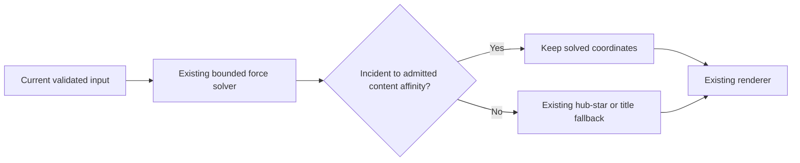

# Preserve semantic coordinates in overview fallback placement

The engine computed content-affinity coordinates and then replaced them with
hub-star and duplicate-title geometry. On a current1984-node career snapshot,
the final star step moved1689 of1767 nodes incident to an admitted affinity.
On a five-project snapshot it moved492 of586 such nodes. An observer-only copy
of the actual source counted the moves and produced exactly identical final
anchors/clusters to the uninstrumented baseline. This is code/geometry evidence,
not proof that the underlying E5 similarities are semantic truth.

The final star and duplicate-title steps now act as fallback for nodes without
admitted content affinities. Endpoints retained by the existing bounded affinity
selector keep their already solved coordinates; authoritative pins retain their
existing handling. Rejected/missing affinities retain the structural fallback.
Nodes, memberships, cluster IDs, source relationships/direction, labels, identities,
merge decisions, embedding/profile, edge strengths and budgets are unchanged.

Two new regressions failed on the baseline: changing an admitted semantic neighbor
did not change a star leaf's final coordinate, and a duplicate-title disk likewise
erased its semantic movement. A third check preserves fallback for malformed or
unavailable affinity input. These three and existing pin/force/budget checks pass;
the final full frontend suite passed1150 checks in103 files and TypeScript/Vite
build passed. Existing large-chunk warnings remain. Those tests are not pixel,
physical gesture, Retina, GPU/FPS, battery or full installed-app evidence.

Read-only captures came through the installed graph and affinity endpoints, with
exact ordered target/version refs. Five CPU replays per saved input were
deterministic. Same-membership comparison on the1984-node career snapshot reduced
3D point pairs closer than0.025 world units from865 to14; exact coincident pairs
remained0. The fraction inside the declared central ellipsoid threshold changed
0→0.003024. On the1984-node union snapshot, close pairs changed239→113 with0 exact
coincidences and central fraction0 in both. These are world-space diagnostics,
not screen-space overlap or a universally optimal packing result.

Independent standard-library arithmetic matched the exact SHA-256 of1984 career
and588 union vector blobs to the saved source/vector proofs. In the career case,
1024 admitted-pair median distance changed1.4094→0.2461 world units;278 same-cluster
pairs not directly admitted changed1.4544→0.1841 (median E5 cosine0.9337).
The8192 seeded eligible noncandidate random-pair median changed1.5995→2.0483.
On the union input,790 admitted pairs changed0.4487→0.4403 and307 held-out
within-cluster pairs0.4980→0.3986; its8192 random pairs changed1.4290→0.6753.
The cohorts are separate and not combined into a significance/causality claim.
The original vector space is part of the layout mechanism, so even held-out
cosine checks are not independent human gold, entity equivalence or fact validity.

The union capture excluded1396 of1984 displayed records from content affinity
(871 empty bodies,518 metadata descriptions,7 source-metadata-only records).
Missing content evidence is not repaired by moving points. Its1396 excluded
records retain fallback geometry; whole messenger/media acquisition remains a
separate gate. Pair sampling remains partial:65,536 comparisons cover about3.33%
of eligible career pairs and52.0% of eligible union pairs.

A separate read-only experiment used the already supported max_candidates4096
option while preserving the same source/vector proofs and65,536 comparisons.
It returned2755 pairs, covered1984 rather than1767 candidate endpoints, and changed
career community count989→604. With the old final placement, only89 final positions
changed. This corroborates the overwrite mechanism but is not a promotion of a
larger budget. The product default1024 and all other budgets remain unchanged.

The protection set adds O(P) work/storage for at most4096 admitted semantic pairs
and a bounded union with existing fallback-owned IDs. It removes no source queries
and changes no solver complexity. Sequential CPU timings from the private
experiments do not establish a speedup. Exact source hashes, raw/probe/setup
failures, geometry/vector reports, canonical build, native render and installed
readback belong under the task output `layout-quality-20261025`; completion of a
later gate is never inferred from this source document.

This is a scoped defect fix restoring the meaning of an existing force solver.
Current-source external Pro/Gemini/reverse validation remains incomplete under
the preserved upload gate. Local regressions, observer alignment and the flowchart
do not constitute an all-input refinement, safety or liveness proof.

The first scope3 native capture succeeded, but the reused wrapper wrongly expected
zoom and body-notation outputs that this source had not implemented. Its missing-file
failure is retained; it is not zoom acceptance. The old path also could not attest
transparent/minimized operation. The maintained graph-only audit now creates its
owned windows hidden, unfocused and incognito, sets alpha0 and normal level before
ordering the graph, verifies nonkey/inactive state for each zoom capture, then
minimizes and reads back eight observations. The original primary app is not
adopted or given synthetic input. A minimized-primary physical journey remains
unverified. Actual native pass/failure receipts remain authoritative.

Scope3 now checks distant/context/detail/returned zoom states at two sizes,
including zero passive labels at fitted and distant zoom, positive labels when
zoomed in, and bounded label/caption rectangles without overlap or clipping.
This is actual product camera/render code with synthetic wheel input, not
physical gestures, font-ink bounds, Retina or performance proof. The audit
changes no product label policy or source data and admits no control writes.
